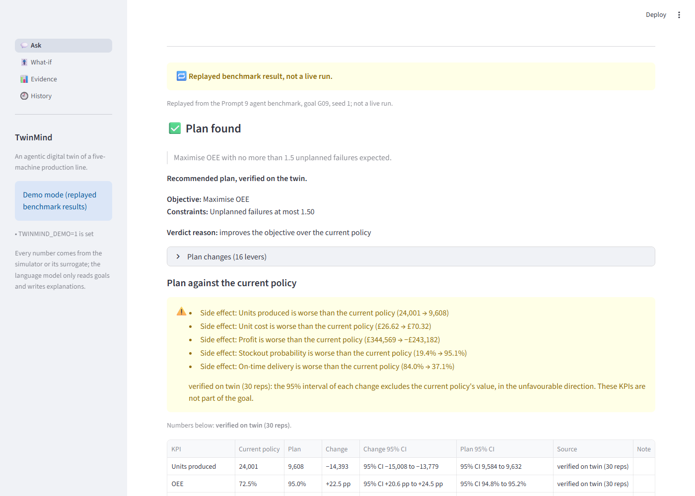
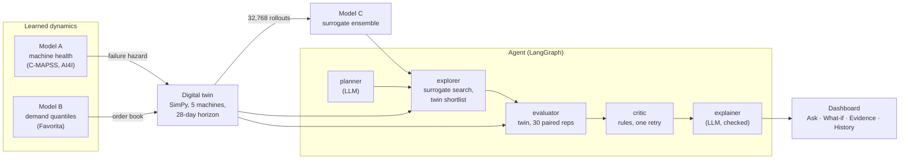
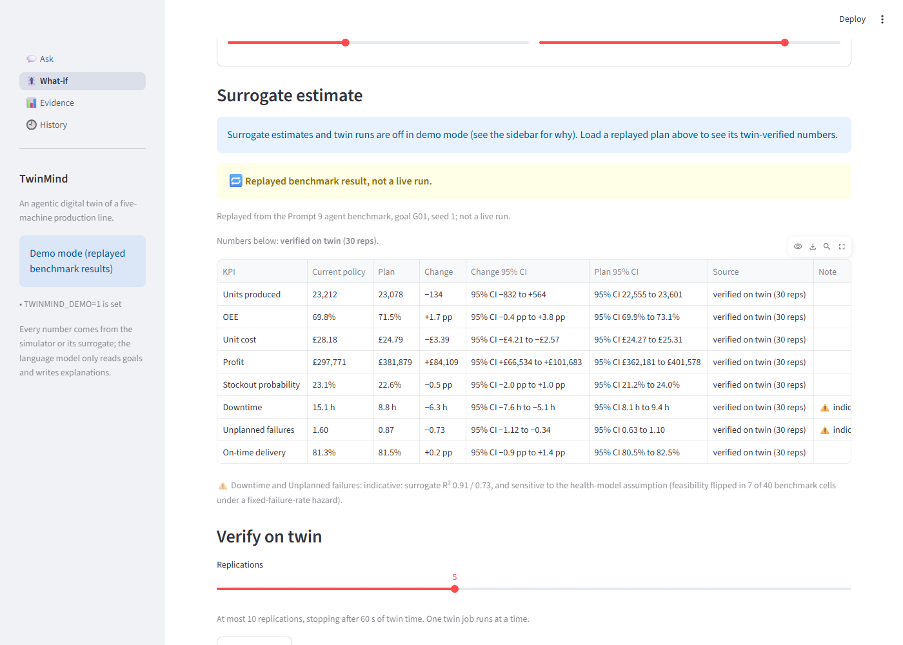
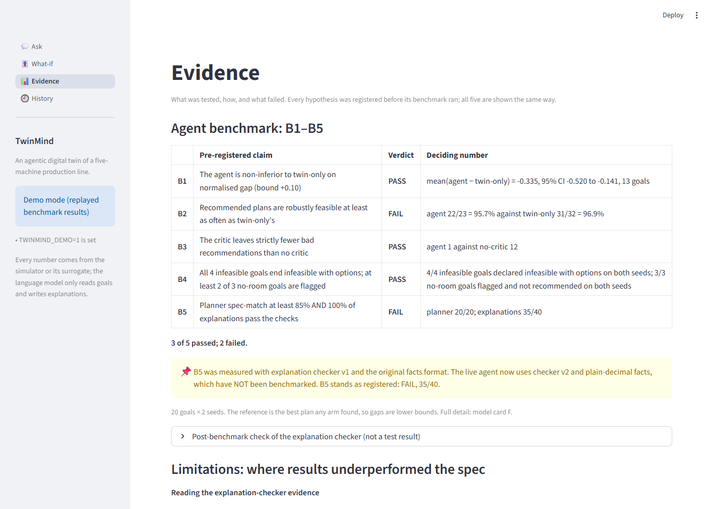

# TwinMind

An agentic digital twin of a five-machine production line. You type a planning
goal in plain English; an agent turns it into a precise objective, searches
plans on a learned surrogate, verifies the chosen plan on a discrete-event
simulator against the current policy, and explains the result.

**The language model only reads goals and writes explanations.** Every KPI,
comparison, interval and constraint check is deterministic Python, and the
dashboard says which numbers are surrogate *estimates* and which are *verified
on the twin*, with their intervals.



---

## How it fits together



The LLM (Groq, `openai/gpt-oss-20b`) is used by the **planner** and the
**explainer** only, at most 6 calls per goal. Its explanation is checked against
the facts (numbers, directions, the stated reason, and no overclaiming words)
and replaced by a fixed template if it fails twice.

---

## Quickstart: demo mode (no key, no data)

Demo mode runs every page on six replayed benchmark results committed in
`app/demo_cache/`. It needs no API key, no datasets and no trained models.

```bash
python -m venv .venv
```

```bash
.venv\Scripts\activate
```

```bash
python -m pip install torch --index-url https://download.pytorch.org/whl/cpu
```

```bash
python -m pip install -e ".[dev]"
```

```bash
python -m streamlit run app/main.py -- --demo
```

Every replayed result carries a visible **"replayed benchmark result, not a
live run"** label.

### Live mode

Live mode needs a Groq key and the local model and data files (which are not in
the repository: see *Reproduce*).

```bash
copy .env.example .env
```

Put your key after `GROQ_API_KEY=` in `.env` (never commit it; `.env` is
gitignored). Then start without `--demo`:

```bash
python -m streamlit run app/main.py
```

The sidebar says which mode is active and why. Live mode runs **one goal at a
time** in the Streamlit process (no background workers), shows each agent step
and the LLM calls used against the cap, and records every run in History as
finished, replayed or aborted. If the language model cannot be reached, the
closest replayed goal is shown instead, labelled as a replay.

---

## The dashboard

| Page | What it shows |
|---|---|
| **Ask** | A goal → objective, constraints, the plan, any **side effects** (a KPI outside the goal whose verified change is worse beyond its 95% interval), a KPI table against the current policy (verified on the twin, 30 reps, with 95% CIs), critic flags in plain English, closest-achievable options for infeasible goals, training-coverage band, and the explanation, which has passed an automated check of numbers and KPI directions (with what that check does not catch). |
| **What-if** | 16 levers. The surrogate's **estimate** (means only, never an interval) plus a novelty band; then **Verify on twin**: at most 10 replications under a 60 s cap, with the measured seconds. |
| **Evidence** | B1–B5 with both FAILs, the model cards, the figures, and every "Underperformed the spec" section. |
| **History** | Every dashboard event, with live runs and replays labelled differently, plus the agent's own run log. |

What the dashboard will not do: show the surrogate's epistemic std (it does not
separate out-of-distribution plans: AUROC 0.590), mix estimates and verified
numbers in one table, or describe a plan with overclaiming words (a fixed list,
enforced by tests on everything the pages render). Downtime and
unplanned failures always carry this badge: *indicative: surrogate R² 0.91 /
0.73, and sensitive to the health-model assumption (feasibility flipped in 7 of
40 benchmark cells under a fixed-failure-rate hazard).* Each rule has a test.



---

## Results

### Agent benchmark (pre-registered; 20 goals × 2 seeds)

| | Pre-registered claim | Verdict | Deciding number |
|---|---|---|---|
| **B1** | The agent is non-inferior to twin-only search on normalised gap | **PASS** (and superior) | mean(agent − twin-only) = −0.335, 95% CI −0.520 to −0.141 |
| **B2** | Recommended plans are robustly feasible at least as often as twin-only's | **FAIL** | agent 22/23 = 95.7% against twin-only 31/32 = 96.9% |
| **B3** | The critic leaves strictly fewer bad recommendations | **PASS** | 1 against 12 without the critic |
| **B4** | Impossible and pointless goals are handled | **PASS** | 4/4 infeasible goals with options; 3/3 no-room goals flagged |
| **B5** | Planner spec-match ≥ 85% AND 100% of explanations pass the checks | **FAIL** | planner 20/20; explanations **35/40** |

**B5 was measured with explanation checker v1 and the original facts format.
The live agent now uses checker v2 and plain-decimal facts, which have NOT been
benchmarked.** B5 stands as registered: **FAIL, 35/40.** A post-benchmark
mutation test (not a test result) found v2 catches everything v1 catches, and
found one benchmark explanation v1 passed that states a direction wrongly
([model card F §8](reports/model_cards/f_agent_benchmark.md)).



### Components

| Component | Headline | Against its target |
|---|---|---|
| A1 machine health (C-MAPSS FD001) | RMSE 12.76 ± 0.16 at the production preset | Parity with the random forest (12.72 ± 0.16), not better |
| A2 failure classifier (AI4I) | PR-AUC 0.869; recall at 80% precision 0.811 | Recall target 0.90 **missed**; PR-AUC target revised from 0.90 to 0.85, because only a model fed the leaked failure-mode columns reaches 0.90 (card A2) |
| B demand (Favorita, LightGBM quantile) | relative MAE 0.878 | Missed (≤ 0.85); N-HiTS meets it at 0.838 but is not in production |
| C surrogate | R² ≥ 0.95 on 6 of 8 KPIs | Missed on downtime (0.907) and unplanned failures (0.733); epistemic std fails OOD detection (AUROC 0.590) |
| D optimiser (held-out benchmark) | median gap 0.129 for surrogate-first TPE | **All four hypotheses FAIL as registered**; two pass when the two goals no method could satisfy are excluded |
| E agent planner | spec-match 15/17, adversarial 5/5 | Clarification **4/6, FAIL** (≥ 75%) |
| F agent benchmark | see above | 3 PASS, 2 FAIL |

Every number links back to a model card in
[`reports/model_cards/`](reports/model_cards/), and each card has a section on
where it underperformed.

---

## Limitations

- **It is a statement about a simulator, not a factory.** The twin is not
  validated against a real line; its demand-to-capacity ratio is an assumption
  that moves profit substantially.
- **Weak KPIs.** The surrogate predicts downtime and unplanned failures worst,
  and feasibility on goals that constrain them flipped in 7 of 40 benchmark
  cells when the learned hazard was swapped for a fixed failure rate.
- **The explanation checker has known gaps.** Neither version catches negation
  ("profit does not rise" when it rose), a wrong direction for a plan change, or
  a KPI name swapped for one that moved the same way. The KPI table is the
  record; the explanation is a reading of it.
- **The benchmark is small**: 20 goals, 2 seeds, a reference that is the best
  plan any arm found (so gaps are lower bounds), and a free-tier LLM.
- **Clarification is weak** (4/6), and the benchmark had no clarification goal.
- **Live goals are slow**: one goal took 106–205 s on one worker in the agent
  card's demo, most of it twin time.
- **Speed figures were measured on a quiet, plugged-in machine.** On a busy or
  hot laptop the twin runs slower: its 250 ms-per-run performance test failed
  twice at about 434 ms and passed when the machine was quiet. The threshold was
  not changed. No speed-up measured on a busy machine is quoted anywhere.

---

## Repository map

```
app/
  main.py          Streamlit entry point (navigation, sidebar)
  views/           ask.py, whatif.py, evidence.py, history.py
  demo_cache/      six replayed benchmark results (no secrets, no data paths)
configs/           data, twin, models, agent YAMLs, validated by Pydantic
src/twinmind/
  data/            downloads, loaders, windowing, features
  models/          A (health), B (demand), C (surrogate)
  twin/            SimPy line, demand process, costs, runner
  optim/ optimise/ search, surrogate-first verification, novelty, baselines
  agents/          LangGraph graph, planner, critic, tools, explanation v1 and v2
  ui/              viewmodel.py and services.py (no Streamlit), components.py
  eval/ utils/     metrics, registry, figures; paths, config, logging
scripts/           CLI entry points (data, training, benchmarks, demo cache)
tests/             pytest suite; CI runs it with no network, no key, no data
reports/           model cards, pre-registrations, results JSON, figures
docs/              dashboard screenshots
```

---

## Reproduce

The datasets, rollouts and trained models are gitignored (Favorita cannot be
redistributed). Long jobs are listed with the card that documents them; run
them one at a time with at most 3 workers on an 8 GB machine.

1. Data: `python scripts/download_data.py --dataset all` (Kaggle credentials in
   `.env`), then the caches: `scripts/build_health_cache.py`,
   `scripts/build_demand_cache.py`.
2. Models A and B: `scripts/train_health.py`, `scripts/train_ai4i.py`,
   `scripts/train_demand.py` (cards A1, A2, B).
3. Twin rollouts and surrogate: `scripts/generate_rollouts.py`,
   `scripts/train_surrogate.py` (cards twin_design, C).
4. Optimiser benchmark: `scripts/run_optim_benchmark.py`,
   `scripts/analyse_optim_benchmark.py` (card D).
5. Agent benchmark: `scripts/run_agent_bench.py --workers 3`, then `--audit`,
   `scripts/analyse_agent_bench.py`, `scripts/ablate_agent_bench.py` (card F).
6. Post-benchmark checks (no LLM): `scripts/recheck_explanations_v2.py`,
   `scripts/mutation_test_explanations.py`; demo cache:
   `scripts/build_demo_cache.py`.

Each card's *Reproduce* section has the exact flags.

### Tests

```bash
python -m pytest -m "not data"
```

That is what CI runs (Python 3.11 and 3.12), with no network, no Groq key and
no datasets; the dashboard is tested in demo mode with Streamlit's AppTest. Tests
that need local data carry the `data` marker:

```bash
python -m pytest -m "data"
```

Lint and types: `python -m ruff check .`, `python -m ruff format --check .`,
`python -m mypy src/`.

---

## Working on this repo

`main` stays green; feature work goes on `feat/<area>` branches, squash-merged
with a conventional-commit title ([CONTRIBUTING.md](CONTRIBUTING.md)). Install
the pre-commit hooks once per clone with `python -m pre_commit install`.

**The repository is private**, because Favorita data cannot be redistributed and
this is graded work. `.env.example` holds placeholders only; real credentials
belong in `.env`, which is ignored.
