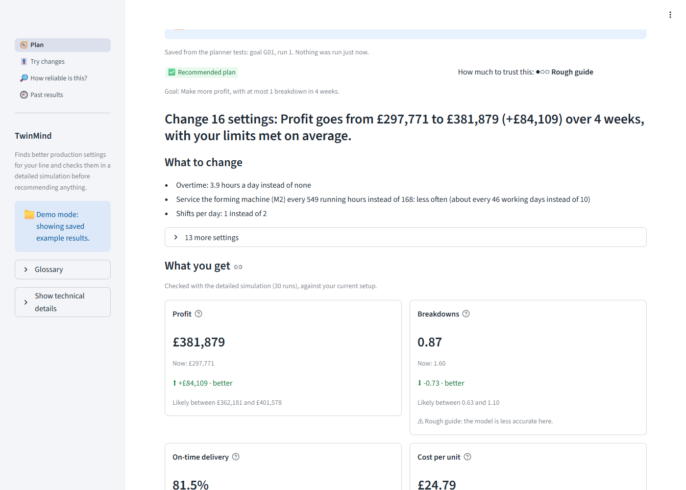
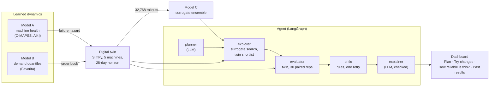
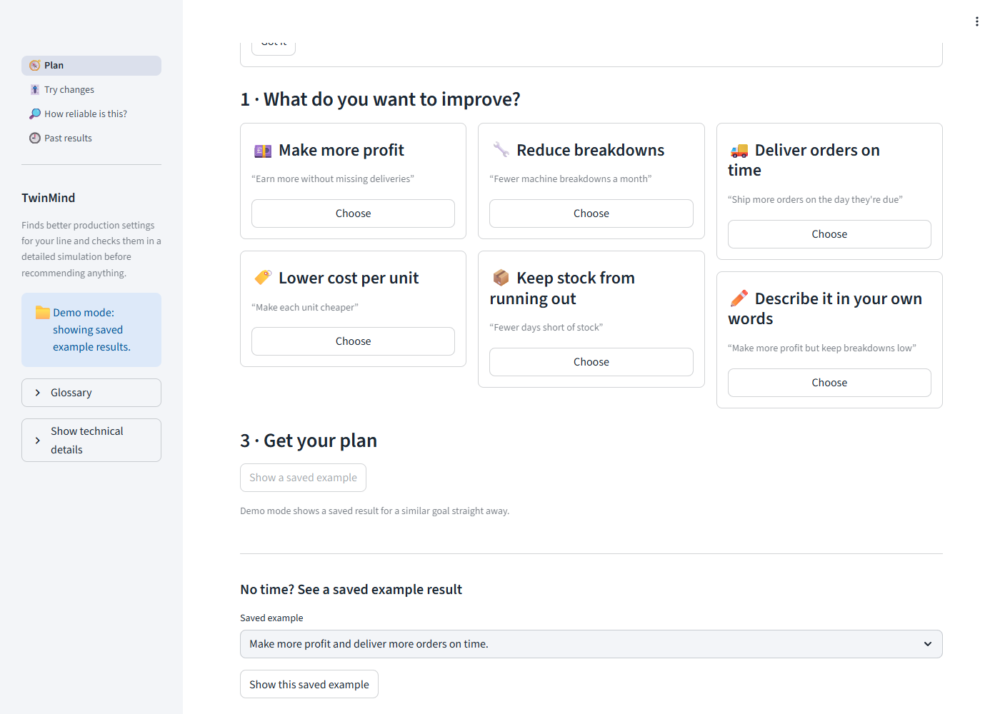
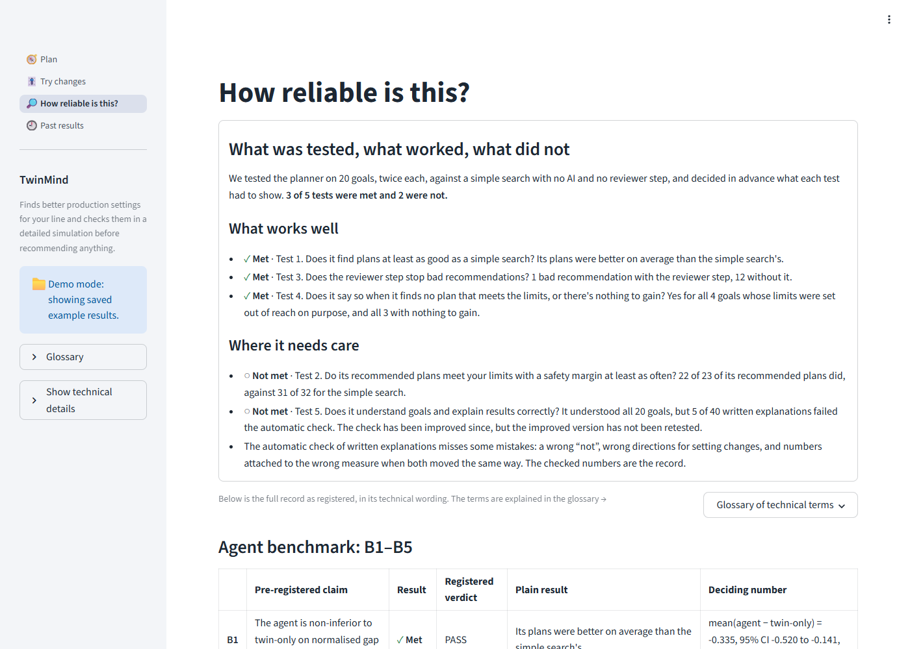

# TwinMind

Finds better settings for a five-machine production line and checks them in a
detailed simulation before recommending anything. A factory manager picks what
to improve (more profit, fewer breakdowns, on-time delivery, lower cost per
unit, fewer days short of stock), sets the limits they can live with, and gets
one sentence back: what to change and what it gives, with the evidence behind
it.

**The AI only reads goals typed in your own words and writes a summary.** Every
number, comparison and limit check is deterministic Python: a quick estimate
from a learned model, then a detailed simulation (30 runs) of the chosen plan
against your current setup.



---

## How it fits together



The LLM (Groq, `openai/gpt-oss-20b`) is used by the **planner** (only for goals
typed in your own words) and the **explainer**, at most 6 calls per goal. Its
explanation is checked against the facts (numbers, directions, the stated
reason, and no overclaiming words) and replaced by a fixed template if it fails
twice.

---

## Try it in five minutes (demo mode: no key, no data)

Demo mode shows eight **saved example results** from the agent benchmark. It
needs no API key, no datasets and no trained models, and every result says
"Saved example result, not a live run".

1. Install (once):

```bash
python -m venv .venv
```

```bash
.venv\Scripts\activate
```

```bash
python -m pip install torch --index-url https://download.pytorch.org/whl/cpu
```

```bash
python -m pip install -e ".[dev]"
```

2. Start:

```bash
python -m streamlit run app/main.py -- --demo
```

3. In the browser: on **Plan**, choose a goal card (for example *Make more
   profit*), then press **Show a saved example**. Read the sentence at the top,
   then *What to change*, *What you get*, *Before you act* and *How much to
   trust this*. Everything technical is under **Show technical details**.

### Live mode (finds new plans)

Live mode needs a Groq key and the local model and data files (not in the
repository: see *Reproduce*).

```bash
copy .env.example .env
```

Put your key after `GROQ_API_KEY=` in `.env` (never commit it; `.env` is
gitignored). Then start without `--demo`:

```bash
python -m streamlit run app/main.py
```

Choose a goal card, set any limits, and press **Find a plan**. It usually takes
2–4 minutes; you can keep using the app meanwhile. A banner on every page shows
that a plan is being worked out, with a **Cancel** button and a 10-minute limit.
One plan is worked out at a time. If the AI service can't be reached, the app
says so in plain words and shows a saved example for a similar goal instead,
labelled as such.

---

## The dashboard

| Page | What a manager does there |
|---|---|
| **Plan** | Pick what to improve from six cards (or describe it in your own words), set limits in business units (most breakdowns in 4 weeks, lowest on-time delivery, …), press one button. The result leads with one sentence and a status (*Recommended plan*; *Your current setup is already close to the best we could find*; *We couldn't find a plan that meets these limits. Closest options below.*), then *What to change* (settings in plain words with units), *What you get* (four numbers, before → after, better / worse / no clear change, each with its likely range, and the rest in a *More numbers* table), *Before you act* (side effects and risks, worded as things worth checking), *Why this plan* (numbers only, no claims about causes), and *How much to trust this*, with what the result cost to work out. |
| **Try changes** | Move the 16 settings, grouped as *Shifts and overtime*, *Maintenance*, *Machine speed*, *Stock and ordering*. See a **quick estimate** (instant, rough, never with a range), then **Check with the detailed simulation** (10 runs, a few seconds; numbers with "likely between" ranges). |
| **How reliable is this?** | A short plain summary (*What works well*: the three tests that were met; *Where it needs care*: the two that were not, B2 and B5, and the checker's limits), then the full record, all visible: the B1–B5 table with neutral *Met* / *Not met* labels in equal weight beside each registered PASS/FAIL, what each not-met result means and does not mean, the checker-v1/v2 note and caveats, the post-benchmark checker table, the Limitations, the model cards and the figures, with a glossary of the technical terms. |
| **Past results** | Every plan and saved example, newest first; live runs and saved examples labelled apart; click a row to reopen it. |

**How much to trust this** is a fixed rule, not a score: the plan's numbers
come from the detailed simulation; the limits are met with a safety margin; the
settings are close to ones the model has seen; and the goal doesn't depend on
breakdown or downtime numbers (the model's weakest). All four → *Checked*; one
missing → *Partly checked*; two or more, or no detailed simulation → *Rough
guide*. The reasons are listed under it; there are no probabilities.

What the dashboard will not do, each enforced by a test:

- use jargon in its default view (a test walks every rendered string, outside
  the "Show technical details" sections, against a banned-word list);
- mix quick estimates and checked numbers;
- show the quick-estimate model's own uncertainty (it does not flag unfamiliar
  plans: AUROC 0.590); a familiar / less familiar / unfamiliar territory check
  is shown instead;
- describe a plan with overclaiming words, or call an AI explanation's check
  "verified";
- hide that breakdown and downtime numbers are rough guides. The exact
  technical badge (*indicative: surrogate R² 0.91 / 0.73, and sensitive to the
  health-model assumption …*) is kept under Show technical details.

The agent gained one **read-only progress hook** for the dashboard
(`run_on_spec_streaming`, beside `run_agent_streaming`): the same graph and
nodes, tested to return exactly what `run_on_spec` returns. The benchmark does
not use it and is unaffected.



---

## Results

### Agent benchmark (pre-registered; 20 goals × 2 seeds)

| | Pre-registered claim | Verdict | Deciding number |
|---|---|---|---|
| **B1** | The agent is non-inferior to twin-only search on normalised gap | **PASS** (and superior) | mean(agent − twin-only) = −0.335, 95% CI −0.520 to −0.141 |
| **B2** | Recommended plans are robustly feasible at least as often as twin-only's | **FAIL** | agent 22/23 = 95.7% against twin-only 31/32 = 96.9% |
| **B3** | The critic leaves strictly fewer bad recommendations | **PASS** | 1 against 12 without the critic |
| **B4** | Impossible and pointless goals are handled | **PASS** | 4/4 infeasible goals with options; 3/3 no-room goals flagged |
| **B5** | Planner spec-match ≥ 85% AND 100% of explanations pass the checks | **FAIL** | planner 20/20; explanations **35/40** |

**B5 was measured with explanation checker v1 and the original facts format.
The live agent now uses checker v2 and plain-decimal facts, which have NOT been
benchmarked.** B5 stands as registered: **FAIL, 35/40.** A post-benchmark
mutation test (not a test result) found v2 catches everything v1 catches, and
found one benchmark explanation v1 passed that states a direction wrongly
([model card F §8](reports/model_cards/f_agent_benchmark.md)).



### Components

| Component | Headline | Against its target |
|---|---|---|
| A1 machine health (C-MAPSS FD001) | RMSE 12.76 ± 0.16 at the production preset | Parity with the random forest (12.72 ± 0.16), not better |
| A2 failure classifier (AI4I) | PR-AUC 0.869; recall at 80% precision 0.811 | Recall target 0.90 **missed**; PR-AUC target revised from 0.90 to 0.85, because only a model fed the leaked failure-mode columns reaches 0.90 (card A2) |
| B demand (Favorita, LightGBM quantile) | relative MAE 0.878 | Missed (≤ 0.85); N-HiTS meets it at 0.838 but is not in production |
| C surrogate | R² ≥ 0.95 on 6 of 8 KPIs | Missed on downtime (0.907) and unplanned failures (0.733); epistemic std fails OOD detection (AUROC 0.590) |
| D optimiser (held-out benchmark) | median gap 0.129 for surrogate-first TPE | **All four hypotheses FAIL as registered**; two pass when the two goals no method could satisfy are excluded |
| E agent planner | spec-match 15/17, adversarial 5/5 | Clarification **4/6, FAIL** (≥ 75%) |
| F agent benchmark | see above | 3 PASS, 2 FAIL |

Every number links back to a model card in
[`reports/model_cards/`](reports/model_cards/), and each card has a section on
where it underperformed.

---

## Limitations

- **It is a statement about a simulator, not a factory.** The twin is not
  validated against a real line; its demand-to-capacity ratio is an assumption
  that moves profit substantially.
- **Weak KPIs.** The surrogate predicts downtime and unplanned failures worst,
  and feasibility on goals that constrain them flipped in 7 of 40 benchmark
  cells when the learned hazard was swapped for a fixed failure rate.
- **The explanation checker has known gaps.** Neither version catches negation
  ("profit does not rise" when it rose), a wrong direction for a plan change, or
  a KPI name swapped for one that moved the same way. The KPI table is the
  record; the explanation is a reading of it.
- **The benchmark is small**: 20 goals, 2 seeds, a reference that is the best
  plan any arm found (so gaps are lower bounds), and a free-tier LLM.
- **Clarification is weak** (4/6), and the benchmark had no clarification goal.
- **Live goals are slow**: one goal took 106–205 s on one worker in the agent
  card's demo, most of it twin time.
- **Speed figures were measured on a quiet, plugged-in machine.** On a busy or
  hot laptop the twin runs slower: its 250 ms-per-run performance test failed
  twice at about 434 ms and passed when the machine was quiet. The threshold was
  not changed. No speed-up measured on a busy machine is quoted anywhere.

---

## Repository map

```
app/
  main.py          Streamlit entry point (navigation, sidebar, running banner)
  views/           plan.py, try_changes.py, reliability.py, past_results.py
  demo_cache/      eight saved example results (no secrets, no data paths)
.streamlit/        config.toml: the calm light theme, toolbar hidden
configs/           data, twin, models, agent YAMLs, validated by Pydantic
src/twinmind/
  data/            downloads, loaders, windowing, features
  models/          A (health), B (demand), C (surrogate)
  twin/            SimPy line, demand process, costs, runner
  optim/ optimise/ search, surrogate-first verification, novelty, baselines
  agents/          LangGraph graph, planner, critic, tools, explanation v1 and v2
  ui/              glossary, goals, plain, jobs, viewmodel, services (no Streamlit);
                   components.py (the only Streamlit module)
  eval/ utils/     metrics, registry, figures; paths, config, logging
scripts/           CLI entry points (data, training, benchmarks, demo cache)
tests/             pytest suite; CI runs it with no network, no key, no data
reports/           model cards, pre-registrations, results JSON, figures
docs/              dashboard screenshots, ux_spec.md (the redesign spec)
```

---

## Reproduce

The datasets, rollouts and trained models are gitignored (Favorita cannot be
redistributed). Long jobs are listed with the card that documents them; run
them one at a time with at most 3 workers on an 8 GB machine.

1. Data: `python scripts/download_data.py --dataset all` (Kaggle credentials in
   `.env`), then the caches: `scripts/build_health_cache.py`,
   `scripts/build_demand_cache.py`.
2. Models A and B: `scripts/train_health.py`, `scripts/train_ai4i.py`,
   `scripts/train_demand.py` (cards A1, A2, B).
3. Twin rollouts and surrogate: `scripts/generate_rollouts.py`,
   `scripts/train_surrogate.py` (cards twin_design, C).
4. Optimiser benchmark: `scripts/run_optim_benchmark.py`,
   `scripts/analyse_optim_benchmark.py` (card D).
5. Agent benchmark: `scripts/run_agent_bench.py --workers 3`, then `--audit`,
   `scripts/analyse_agent_bench.py`, `scripts/ablate_agent_bench.py` (card F).
6. Post-benchmark checks (no LLM): `scripts/recheck_explanations_v2.py`,
   `scripts/mutation_test_explanations.py`; demo cache:
   `scripts/build_demo_cache.py`.

Each card's *Reproduce* section has the exact flags.

### Tests

```bash
python -m pytest -m "not data"
```

That is what CI runs (Python 3.11 and 3.12), with no network, no Groq key and
no datasets; the dashboard is tested in demo mode with Streamlit's AppTest. Tests
that need local data carry the `data` marker:

```bash
python -m pytest -m "data"
```

Lint and types: `python -m ruff check .`, `python -m ruff format --check .`,
`python -m mypy src/`.

---

## Working on this repo

`main` stays green; feature work goes on `feat/<area>` branches, squash-merged
with a conventional-commit title ([CONTRIBUTING.md](CONTRIBUTING.md)). Install
the pre-commit hooks once per clone with `python -m pre_commit install`.

**The repository is private**, because Favorita data cannot be redistributed and
this is graded work. `.env.example` holds placeholders only; real credentials
belong in `.env`, which is ignored.
