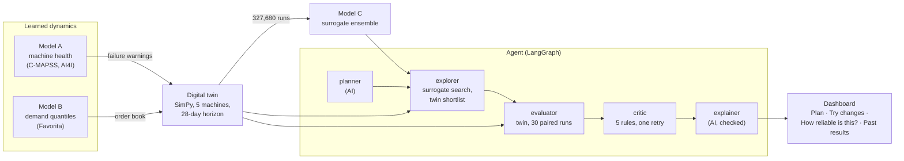

# TwinMind

**An agentic digital twin of a five-machine production line.** A factory manager
picks what to improve (more profit, fewer breakdowns, on-time delivery, lower
cost per unit, fewer days short of stock), sets the limits they can live with,
and gets back one sentence: what to change and what it gives. Behind that
sentence, a learned *quick-estimate* model searches hundreds of plans, a
discrete-event simulation checks the best of them **30 times against the
current setup**, a rule-based reviewer looks for risks, and an AI writes a
summary that is automatically checked against the numbers.

**The language model never produces a number.** It only turns a goal typed in
your own words into a precise goal, and writes the summary. Every KPI,
comparison, interval and limit check is deterministic Python, and the dashboard
always says which numbers are *quick estimates* and which were *checked with the
detailed simulation*, with their likely ranges.


---

## Contents

1. [At a glance](#at-a-glance)
2. [How a plan is found](#how-a-plan-is-found)
3. [The components, one by one](#the-components-one-by-one)
4. [The dashboard](#the-dashboard)
5. [Results](#results)
6. [Try it: demo mode and live mode](#try-it-demo-mode-and-live-mode)
7. [Configuration](#configuration)
8. [Tests and CI](#tests-and-ci)
9. [Reproduce everything](#reproduce-everything)
10. [Limitations](#limitations)
11. [Repository map](#repository-map)
12. [Release history](#release-history)
13. [Working on this repo](#working-on-this-repo)

---

## At a glance

| | |
|---|---|
| **The line** | 5 machines in series (cutting → forming → welding → finishing → packing), finite buffers, an (s, Q) raw-material policy with 3 suppliers, lost sales, a 28-day planning horizon |
| **What it learns from** | NASA C-MAPSS turbofan run-to-failure data (machine health), UCI AI4I 2020 (failure classifier), Kaggle Favorita store sales (demand: the top 200 of 1,782 series) |
| **Decisions** | 16 settings the planner may change (shifts, overtime, line pace, 5 service intervals, 5 machine speeds, reorder point, order size, safety stock) plus 2 "what-if" inputs (supplier, price) |
| **KPIs** | profit, units made, OEE, cost per unit, days short of stock, downtime, unplanned failures, on-time delivery |
| **Models** | A1 CNN-BiLSTM remaining-life model (blended 50/50 with a random forest), A2 LightGBM failure classifier, B LightGBM quantile demand forecaster with conformal calibration, C a 5-member heteroscedastic MLP surrogate of the twin |
| **Agent** | LangGraph graph: planner → explorer → evaluator → critic → explainer; Groq `openai/gpt-oss-20b`; at most 6 AI calls per goal |
| **Evidence** | three pre-registered benchmarks, eight model cards, five data cards, 40 figures; every shortfall reported, none tuned away |
| **Dashboard** | Streamlit, four pages, plain language for a non-technical manager, demo mode with eight saved example results |
| **Tests** | 1,036 (1,010 run on CI with no network, no key and no data; 26 need the local datasets) |

---

## How a plan is found



What happens when a manager presses **Find a plan**:

1. **Understanding the goal.** A goal card (for example *Make more profit* with
   *at most 1 breakdown in 4 weeks*) is turned into a precise goal directly, with
   no AI call. A goal typed in your own words goes to the **planner**, which
   returns a validated goal, one clarifying question, or a refusal; a malformed
   reply gets at most 2 repairs.
2. **Searching.** The **explorer** runs 600 TPE trials on the surrogate (Model C),
   with each limit tightened by one predicted standard deviation, then picks 20
   *distinct* candidates and checks all of them on the twin (10 runs each).
3. **Checking the best.** The **evaluator** runs the chosen plan and the current
   setup 30 times each on an independent random stream, **paired** run by run,
   and reports every KPI's mean, its 95% interval, the paired change and whether
   each limit is met on average and with a safety margin.
4. **Reviewing for risks.** The **critic** applies five fixed rules (below). If
   the limits are met only on average, it swaps to a safer already-checked
   candidate or searches once more with a wider margin. If no plan meets the
   limits, it offers the closest values any checked plan reached, as options
   for the manager to decide on, not decisions.
5. **Writing the summary.** The **explainer** sees only the facts (never the
   goal text). Its text must pass an automated check of numbers, KPI directions,
   the stated reason and overclaiming words; after one failed retry, a fixed
   template is used instead.

The dashboard runs this in **one background thread**, one plan at a time, so
the page stays usable for the 2–4 minutes it takes; a banner on every page
shows progress, the AI calls used, a **Cancel** button and a 10-minute limit.

---

## The components, one by one

Each component has a model card in [`reports/model_cards/`](reports/model_cards/)
with its full method, every number, and a section on where it fell short of its
own targets.

### Data ([data cards](reports/data_cards/))

| Dataset | Use | Notes that matter |
|---|---|---|
| NASA C-MAPSS (FD001–FD004) | machine remaining life and failure warnings | test trajectories stop before failure; true RUL comes from `RUL_<subset>.txt` |
| UCI AI4I 2020 | failure classifier (A2) | the five failure-mode columns reproduce the target for 99.73% of rows, so they are quarantined from the features |
| Kaggle Favorita | demand (B) | 54 stores × 33 families = 1,782 series; the top 200 carry 75.5% of units; transferred holidays handled per store |
| Twin rollouts | surrogate (C) training data | 512 contexts × 64 Sobol scenarios = 32,768 scenarios × 10 runs = **327,680 twin runs** |
| SKAB (optional) | not used by the line | downloaded only with `--include-optional` |

Downloads are checksummed (`manifest.json` per dataset), loaders cache to
parquet, and every learned statistic is fitted on the training split only.

### Model A1 — machine health ([card](reports/model_cards/a1_health.md))

A CNN-BiLSTM with attention pooling (738,626 parameters, MC-dropout) predicts
remaining useful life and the probability of failure within 30 cycles from a
30-cycle sensor window. At the production preset, last-window-per-unit, 3 seeds:

| Subset | A1 RMSE | Random forest | A1 NASA score |
|---|---:|---:|---:|
| FD001 | 12.76 ± 0.16 | **12.72 ± 0.16** | 265.6 ± 11.7 |
| FD002 | **13.78 ± 0.17** | 14.36 ± 0.16 | 908.9 ± 20.4 |
| FD003 | 13.62 ± 0.31 | **13.32 ± 0.49** | 644.4 ± 132.7 |
| FD004 | **15.00 ± 0.17** | 15.68 ± 0.08 | 1109.4 ± 54.5 |

A1 alone only reaches parity with the forest on FD001. **A 50/50 blend of the
two beats both** (FD001 RMSE 12.136, NASA 228, better on every seed) and is the
production health model.

### Model A2 — failure classifier ([card](reports/model_cards/a2_ai4i.md))

LightGBM on AI4I 2020 (base rate 3.39%), 3 seeds, out-of-fold:
**PR-AUC 0.869**, ROC-AUC 0.972, recall at 80% precision **0.811**, ECE 0.0078.
The recall target of 0.90 is **missed**. The PR-AUC target was revised from 0.90
to 0.85 because only a model fed the leaked failure-mode columns reaches 0.90
(it scores 0.977); the card explains this.

### Model B — demand ([card](reports/model_cards/b_demand.md))

A direct multi-horizon **LightGBM quantile** model (q10/q50/q90, 28 days ahead)
on leakage-safe features, scored on 3 rolling-origin folds:

| Model | RMSLE | MAE / best naive | q50 pinball |
|---|---:|---:|---:|
| LightGBM point (L2) | 0.2950 ± 0.1770 | — | 229.23 ± 47.33 |
| **LightGBM quantile (production)** | 0.2527 ± 0.1020 | 0.8784 ± 0.1579 | 221.26 ± 39.29 |
| N-HiTS (comparison) | 0.1972 ± 0.0053 | 0.8382 ± 0.0340 | 211.22 ± 8.65 |

N-HiTS is more accurate; LightGBM ships because it is wired to the calibration
and path sampler the twin uses. The relative-MAE target (≤ 0.85) is **missed**
by the production model. Raw 80% interval coverage was 0.656; per-step
split-conformal calibration lifts it to **0.777** (target band 0.76–0.84, met
on average, not in the day 8–14 bucket). The twin draws daily demand paths from
a Gaussian copula over the calibrated marginals.

### The digital twin ([design card](reports/model_cards/twin_design.md))

```
          (s,Q) supplier
                │
   raw yard ──► M1 ──[200]──► M2 ──[200]──► M3 ──[150]──► M4 ──[150]──► M5 ──► despatch
              cutting        forming       welding      finishing     packing
              120 u/h        110 u/h       100 u/h       115 u/h      130 u/h
                                             ▲ bottleneck
```

- **SimPy, lot-based** (10 units per lot), finite buffers: blocking and starving
  emerge rather than being special-cased.
- **Failures are replayed from real C-MAPSS trajectories**: each machine carries
  an engine and fails at that engine's real failure cycle. The health model plays
  the plant's monitoring system and issues warnings; it can be early, late or
  wrong, and the twin records which. The replay pool is out of sample.
- **Demand** comes from Model B; unmet demand is lost, not backordered.
- **Common random numbers** across scenarios, from separate named streams.
- **Speed, measured on a quiet, plugged-in machine** (150 runs per scenario):
  155 ms per run at the baseline, 183.5 ms in the worst scenario, against a
  250 ms budget. On a busy or hot laptop it runs slower: the 250 ms performance
  test failed twice at about 434 ms and passed once the machine was quiet, and
  the threshold was not changed. No speed figure measured on a busy machine is
  quoted anywhere.
- **Every invented constant is in an assumptions register** and stress-tested
  ±25%. The biggest: `demand_capacity_ratio` (0.85) moves profit by −45% when
  lowered 25%; `lead_time_multiplier` moves it +21% / −26%. Scenario rankings
  stay stable under every assumption (Spearman ρ ≥ 0.88).
- **It is not a validated model of a real factory.** No real throughput, OEE or
  cost data exists for this line; the card says what is and is not validated.

### Model C — surrogate ([card](reports/model_cards/c_surrogate.md))

A 5-member ensemble of heteroscedastic residual MLPs (35 inputs, 4 × 256
residual blocks, a mean and a standard deviation per KPI), bootstrapped over
context blocks, trained with Gaussian NLL in 4.1 minutes on CPU.

| KPI | R² on T1 | Noise ceiling | Target R² ≥ 0.95 |
|---|---:|---:|---|
| units produced | 0.9919 | 0.9990 | hit |
| OEE | 0.9905 | 0.9986 | hit |
| cost per unit | 0.9436 | 0.9717 | hit (by ratio) |
| profit | 0.9816 | 0.9961 | hit |
| stockout probability | 0.9900 | 0.9984 | hit |
| **downtime hours** | **0.9070** | 0.9964 | **miss** |
| **unplanned failures** | **0.7331** | 0.9844 | **miss** |
| on-time delivery | 0.9903 | 0.9984 | hit |

Ranking 1,000 scenarios on one context: Spearman ρ **0.9917** (twin-vs-twin
ceiling 0.9960), top-10 overlap 8/10, and the surrogate's best scenario is the
twin's best. **Its epistemic standard deviation does not flag out-of-distribution
plans** (AUROC 0.590), so the dashboard never shows it; a nearest-neighbour
novelty score (familiar / less familiar / unfamiliar territory) is used instead.

### Model D — optimiser ([card](reports/model_cards/d_optimiser.md))

**Surrogate-first verification**: search on the surrogate with limits tightened
by its predicted standard deviation, shortlist 20 distinct plans, verify them on
the twin, re-evaluate the winner at 30 runs on a stream no optimiser saw.
Feasibility comes first, lexicographically, so no penalty weight trades
stock-outs for pounds.

| Setting | Bounds | Current setup |
|---|---|---|
| `throughput_multiplier` | 0.7 – 1.3 | 1.0 |
| `shift_count` | 1 – 3 | 2 |
| `overtime_hours` | 0 – 4 | 0 |
| `pm_interval_M1` … `M5` | 24 – 720 h | 168, 168, 120, 168, 240 |
| `speed_setpoint_M1` … `M5` | 0.8 – 1.2 | 1.0 |
| `reorder_point` | 0 – 9,000 | 7,000 |
| `order_quantity` | 100 – 10,000 | 6,000 |
| `safety_stock` | 0 – 4,000 | 1,500 |

On the held-out benchmark the pre-registered arm (`sf_tpe`, 3,000 surrogate
trials) had a **median gap of 0.129** to the best plan any method found, ahead
of TPE on the twin (0.558) and CMA-ES on the twin (0.301). **All four
pre-registered hypotheses fail as registered**; two pass when the two goals no
method could satisfy are excluded.

### Model E — the agent ([card](reports/model_cards/e_agent.md))

The model is discovered from Groq's live model list by a rule (no speech or
guard models, ≥ 32k context, ≥ 4k output, fewest parameters, JSON-mode probe),
which picked `openai/gpt-oss-20b`. Every call goes through a `CallBudget`
(at most 6 per goal), with 30 s timeouts, backoff on transient errors and a
token-bucket rate limiter. Every result is a frozen `AgentResult` appended to a
JSONL run log.

The critic's five rules, written to `configs/agent.yaml` before any test:

| Flag | Fires when | Effect |
|---|---|---|
| `weak_kpi_constraint` | a limit is on unplanned failures (R² 0.733) or downtime (0.907) | flag |
| `not_robustly_feasible` | the 95% interval of a limited KPI is not wholly inside the limit | flag; triggers the one retry |
| `novel_plan` | novelty > 0.987382 (the 95th percentile of 1,000 test scenarios) | flag |
| `no_improvement` | the paired objective change's 95% interval does not lie above 0 | not recommended |
| `infeasible_unverified` | no shortlisted plan met every limit on the twin | flag |

Planner evaluation, pre-registered, test split run once: spec-validity 23/23,
spec-match 15/17 (88.2%), refused-or-bounded 5/5, **clarification 4/6 (66.7%,
target ≥ 75%): fail**.

### Model F — the agent benchmark ([card](reports/model_cards/f_agent_benchmark.md))

20 new goals (11 feasible, 4 infeasible, 3 with nothing to gain, 2 vague but
answerable) on contexts no earlier goal used, 2 seeds each, against CMA-ES
driving the twin directly for exactly the agent's wall-clock time, and against
the agent with its critic removed. 80 cells, 3 workers, 39.7 minutes. Results
are in [Results](#results).

---

## The dashboard

Four pages, written for a factory manager; every technical label is kept under
a **Show technical details** expander so nothing is lost for a reviewer.

| Page | What it does |
|---|---|
| **Plan** | Six goal cards (or your own words), limits in business units (most breakdowns in 4 weeks, lowest on-time delivery, highest share of days short of stock, lowest profit, highest cost per unit, overtime yes/no), one button. The result leads with a status and one sentence, then: *What to change* (every moved setting in plain words with units, for example "Service the forming machine (M2) every 549 running hours instead of 168"); *What you get* (four cards, before → after, better / worse / no clear change, each with its likely range, plus a *More numbers* table); *Before you act* (side effects and risks, each with a calm severity); *Why this plan* (numbers and setting changes only, no claims about causes); the AI's own explanation one click away with its check caption; *How much to trust this* and what the result cost to work out. |
| **Try changes** | The 16 settings in four sections (Shifts and overtime, Maintenance, Machine speed, Stock and ordering). A **quick estimate** (instant, rough, never with a range) against your current setup, a familiar-territory line, then **Check with the detailed simulation** (10 runs under a 60-second cap, with the measured seconds and seconds per run). |
| **How reliable is this?** | *What works well* (the three tests that were met) and *Where it needs care* (B2, B5 and the explanation checker's limits) first; then the full record, all visible: the B1–B5 table with neutral Met / Not met labels beside each registered PASS/FAIL, what each not-met result means and does not mean, the checker notes, the post-benchmark checker table, every "Underperformed the spec" section, the model cards and the figures, with a glossary of technical terms. |
| **Past results** | Every plan and saved example, newest first; live runs and saved examples labelled apart; stopped runs shown as "Stopped" with a plain reason; click a row to reopen it. |


**Status of a result.** *Recommended plan*; *Your current setup is already close
to the best we could find*; *We couldn't find a plan that meets these limits.
Closest options below.* (a finite search found none, which is not proof that
none exists); *We need one more detail*; *We couldn't use this goal as written*.

**How much to trust this** is a fixed rule, not a score, from four checks:

| Check | Passes when |
|---|---|
| Checked with the detailed simulation | the numbers come from twin runs |
| Limits met with a safety margin | the plan is recommended and robustly feasible (not applicable otherwise) |
| Familiar territory | the novelty score is at or below 0.987382 |
| No breakdown or downtime numbers in the goal | the goal avoids the two weakest KPIs |

No detailed simulation → *Rough guide*; otherwise 0 failed checks → *Checked*,
1 → *Partly checked*, 2 or more → *Rough guide*. The reasons are always listed;
there are no probabilities. For "no better plan" and "couldn't find a plan" the
indicator describes the conclusion (for example "We searched and checked 20
candidates; none beat your current setup").

**Honesty rules, each enforced by a test:**

- quick estimates and checked numbers are never mixed in one table, and an
  estimate never carries a range;
- every checked number shows its run count and its likely range;
- every saved example says *Saved example result, not a live run* and where it
  came from;
- breakdown and downtime numbers always carry a *rough guide* note; the exact
  technical badge (*indicative: surrogate R² 0.91 / 0.73, and sensitive to the
  health-model assumption …*) is under technical details;
- side effects are always listed: any KPI outside the goal whose 95% change
  interval lies entirely on the bad side (G07's saved example, for instance,
  shows its OEE drop);
- the AI's check is described as "passed an automated check of numbers and KPI
  directions", never "verified", together with what it does not catch;
- no overclaiming words anywhere a page renders;
- no jargon in the default view (a test walks every rendered string outside the
  technical expanders against a banned-word list, and proves it can find a
  planted word);
- no red or error styling for normal outcomes.

**Parity with v1.0.** Each v1.0 page (Ask, What-if, History, Evidence) is kept
as a test fixture and rendered next to its replacement; a test fails if any of
its honesty content is dropped or hidden.

**The agent gained one read-only progress hook** for the dashboard
(`run_on_spec_streaming`, beside `run_agent_streaming`): the same graph and
nodes, tested to return exactly what `run_on_spec` returns. The benchmark does
not use it and is unaffected.


---

## Results

### Agent benchmark (pre-registered; 20 goals × 2 seeds)

| | Pre-registered claim | Result | Deciding number |
|---|---|---|---|
| **B1** | The agent is non-inferior to twin-only search on normalised gap | **Met (PASS)**, and superior | mean(agent − twin-only) = −0.335, 95% CI −0.520 to −0.141 (mean gap 0.196 against 0.531) |
| **B2** | Recommended plans meet the limits with a safety margin at least as often as twin-only's | **Not met (FAIL)** | agent 22/23 = 95.7% against twin-only 31/32 = 96.9% |
| **B3** | The critic leaves strictly fewer bad recommendations | **Met (PASS)** | 1 against 12 without the critic |
| **B4** | Impossible and pointless goals are handled | **Met (PASS)** | 4/4 infeasible goals with options; 3/3 no-room goals flagged |
| **B5** | Planner spec-match ≥ 85% AND 100% of explanations pass the checks | **Not met (FAIL)** | planner 20/20; explanations **35/40** |

**B5 was measured with explanation checker v1 and the original facts format.
The live agent now uses checker v2 and plain-decimal facts, which have NOT been
benchmarked.** B5 stands as registered: **FAIL, 35/40.** A post-benchmark
mutation test (not a test result) found v2 catches every corruption v1 catches
and more (377/397 direction flips in KPI sentences against 306/397), but v2 was
iterated on that same mutation set, so those are development results, not
independent validation. It also found one explanation counted in B5's 35 that
states a direction wrongly, so 35/40 is neither a lower nor an upper bound on
explanation quality. Neither checker catches negation, wrong directions for
setting changes, or a KPI swapped for one that moved the same way.

A pre-declared ablation swapped the learned failure hazard for a fixed failure
rate: rankings mostly held (37 of 40 cells kept their sign), but **feasibility
flipped in 7 cells, all on goals that limit downtime or failures**.

### Components

| Component | Headline | Against its target |
|---|---|---|
| A1 machine health | FD001 RMSE 12.76 ± 0.16; blend 12.136 | parity with the random forest alone; the blend beats both |
| A2 failure classifier | PR-AUC 0.869, recall at 80% precision 0.811 | recall target 0.90 **missed**; PR-AUC target revised to 0.85 (card A2) |
| B demand | relative MAE 0.878, calibrated coverage 0.777 | relative MAE ≤ 0.85 **missed**; coverage met on average |
| Twin | 155 ms per run (quiet machine) | 250 ms budget met; not validated against a real factory |
| C surrogate | R² ≥ 0.95 on 6 of 8 KPIs; ranking ρ 0.9917 | downtime (0.907) and failures (0.733) **missed**; no OOD signal (AUROC 0.590) |
| D optimiser | median gap 0.129 | **all four hypotheses fail as registered** |
| E planner | spec-match 15/17, adversarial 5/5 | clarification 4/6 **fail** |
| F agent benchmark | see above | 3 met, 2 not met |

---

## Try it: demo mode and live mode

### Demo mode (five minutes, no key, no data)

Demo mode shows eight **saved example results** from the agent benchmark. It
needs no API key, no datasets and no trained models.

```bash
python -m venv .venv
```

```bash
.venv\Scripts\activate
```

```bash
python -m pip install torch --index-url https://download.pytorch.org/whl/cpu
```

```bash
python -m pip install -e ".[dev]"
```

```bash
python -m streamlit run app/main.py -- --demo
```

On **Plan**, choose a goal card (for example *Make more profit*) and press
**Show a saved example**. Read the sentence at the top, then *What to change*,
*What you get*, *Before you act* and *How much to trust this*. In demo mode the
limits are greyed out, because the saved example has its own.

### Live mode (finds new plans)

Live mode needs a Groq API key and the local model and data files (not in the
repository; see [Reproduce everything](#reproduce-everything)).

```bash
copy .env.example .env
```

Put your key after `GROQ_API_KEY=` in `.env` (never commit it; `.env` is
gitignored), then start without `--demo`:

```bash
python -m streamlit run app/main.py
```

The sidebar says *Live* when the key and the files are present (otherwise its
"Show technical details" lists why demo mode is on). Choose a goal card, set any
limits and press **Find a plan**. It usually takes 2–4 minutes on one worker
(106–205 s in the agent card's measurements); you can keep using the app. If the
AI service can't be reached, the app says so in plain words and shows a saved
example for a similar goal instead, labelled as such. Live mode loads about
370 MB of models and data once per process; close other heavy programs on an
8 GB machine.

---

## Configuration

| File | Holds |
|---|---|
| `configs/data.yaml` | dataset sources, splits, the Favorita top-N, feature settings |
| `configs/models.yaml` | Models A, B and C hyperparameters and presets |
| `configs/twin.yaml` | machines, buffers, suppliers, costs, the 18-dimension scenario space with bounds, and the assumptions register |
| `configs/agent.yaml` | LLM model rule, call budget, rate limits, explorer settings (600 trials, K = 20), critic thresholds, run-log path |
| `configs/benchmark_design.yaml` | the optimiser benchmark's cells |
| `configs/goals/*.yaml` | 20 dev and held-out goals for the optimiser benchmark |
| `.streamlit/config.toml` | the dashboard theme (calm, light, toolbar hidden) |

Every config maps to a Pydantic model with `extra="forbid"`, so a mistyped key
fails at load time. Environment variables (see `.env.example`; values are never
committed):

| Variable | Meaning |
|---|---|
| `GROQ_API_KEY` | live mode; read from the environment or `.env`, never printed or logged |
| `KAGGLE_API_TOKEN`, or `KAGGLE_USERNAME` + `KAGGLE_KEY` | dataset downloads |
| `TWINMIND_DEMO=1` | force demo mode (same as `-- --demo`) |
| `TWINMIND_DASHBOARD_LOG` | where Past results are stored (default `reports/dashboard_runs.jsonl`, gitignored) |
| `TWINMIND_LOG_LEVEL` | DEBUG, INFO, WARNING or ERROR |

---

## Tests and CI

```bash
python -m pytest -m "not data"
```

That is what CI runs on Python 3.11 and 3.12, with no network, no Groq key and
no datasets. Tests that need local data carry the `data` marker:

```bash
python -m pytest -m "data"
```

| Area | What the tests pin |
|---|---|
| Data | checksums, the AI4I leakage quarantine, truncated C-MAPSS test RUL, non-anticipative Favorita features |
| Twin | determinism, conservation laws, analytic limits, common random numbers, the 250 ms budget (data lane) |
| Surrogate and optimiser | transforms, ranking metrics, feasibility-first ordering, stream separation |
| Agent | every critic rule with a negative control, the call budget, untrusted goal text, the planner's repair loop, both explanation checkers, exact JSON round trips |
| Dashboard | every page in demo mode with Streamlit's AppTest; the jargon ban; every goal card and limit combination; every branch of the trust rule; the background runner (success, error, cancel, time limit, double click); the honesty rules; calm styling; parity with every v1.0 page |

1,036 tests in all: 1,010 on CI and 26 in the data lane. Lint and types:

```bash
python -m ruff check .
```

```bash
python -m ruff format --check .
```

```bash
python -m mypy src/
```

---

## Reproduce everything

The datasets, rollouts and trained models are gitignored (Favorita cannot be
redistributed). Run long jobs one at a time, with **at most 3 workers on an 8 GB
machine**. Each card's *Reproduce* section has the full details.

1. **Data.** Kaggle credentials in `.env`, then:

```bash
python scripts/download_data.py --dataset all
```

2. **Model A** (about 5–7 minutes per seed on CPU for FD001; A2 about 3 minutes):

```bash
python scripts/train_baselines.py --subset FD001
```

```bash
python scripts/train_health.py --subset FD001 --seeds 3
```

```bash
python scripts/train_ai4i.py --model both --seeds 3
```

3. **Model B** and its demand cache for the twin:

```bash
python scripts/train_demand.py --top-n 200 --folds 3
```

```bash
python scripts/build_demand_cache.py
```

4. **Twin**: health cache and validation:

```bash
python scripts/build_health_cache.py
```

```bash
python scripts/validate_twin.py --all
```

5. **Rollouts and Model C** (training takes about 4 minutes on CPU):

```bash
python scripts/generate_rollouts.py
```

```bash
python scripts/train_surrogate.py --members 5 --epochs 120
```

6. **Optimiser benchmark** (card D):

```bash
python scripts/run_optim_benchmark.py --workers 3
```

```bash
python scripts/analyse_optim_benchmark.py
```

7. **Agent**: planner evaluation and a live demo (needs the Groq key):

```bash
python scripts/evaluate_planner.py --split test
```

```bash
python scripts/run_agent.py --demo a
```

8. **Agent benchmark** (card F; the main run took 39.7 minutes on 3 workers):

```bash
python scripts/run_agent_bench.py --workers 3
```

```bash
python scripts/run_agent_bench.py --audit
```

```bash
python scripts/analyse_agent_bench.py
```

```bash
python scripts/ablate_agent_bench.py --workers 3
```

9. **Post-benchmark checks and the saved examples** (no AI calls):

```bash
python scripts/recheck_explanations_v2.py
```

```bash
python scripts/mutation_test_explanations.py
```

```bash
python scripts/build_demo_cache.py
```

Figures come from `scripts/make_figures.py` and the `make_*_figures.py` scripts.

---

## Limitations

- **A statement about a simulator, not a factory.** The twin is not validated
  against a real line, and `demand_capacity_ratio` alone moves profit by up to
  45%.
- **Breakdown and downtime numbers are the weakest.** The surrogate misses its
  accuracy target on both, and feasibility on goals that limit them flipped in 7
  of 40 benchmark cells under a fixed failure rate.
- **The explanation checker misses some mistakes** (negation, setting-change
  directions, same-direction KPI swaps). The checked numbers are the record; the
  AI's text is a reading of them. Checker v2 has not been benchmarked.
- **Small benchmarks**: 20 agent goals × 2 seeds; 5 usable held-out optimiser
  goals. The reference is the best plan any method found, so gaps are lower
  bounds.
- **The agent ran 600 search trials, not the 3,000 benchmarked** in card D.
- **Vague goals are not always questioned** (clarification 4/6), and the agent
  benchmark had no goal that needed a question.
- **A "couldn't find a plan" result comes from a finite search**; it is not
  proof that no plan exists.
- **Demo mode** shows saved results for similar goals; the user's limits are not
  used.
- **Live runs are slow** (2–4 minutes) and use a free-tier LLM (8,000 tokens per
  minute).

---

## Repository map

```
app/
  main.py               entry point: navigation, sidebar, running banner
  views/                plan.py, try_changes.py, reliability.py, past_results.py
  demo_cache/           eight saved example results (no secrets, no data paths)
.streamlit/config.toml  the dashboard theme
configs/                data, models, twin, agent, benchmark design; goals/
src/twinmind/
  data/                 downloads, loaders, C-MAPSS windowing, Favorita features
  models/               A1 (CNN-BiLSTM, forest, blend), A2 (AI4I), B (demand), C (surrogate)
  twin/                 SimPy line, health replay, demand process, costs, runner
  optim/  optimise/     surrogate-first search, novelty, contracts, baselines
  agents/               LangGraph graph, planner, critic, tools, LLM client,
                        explanation checkers v1 and v2, benchmark harness
  ui/                   glossary, goals, plain, jobs, viewmodel, services (no Streamlit);
                        components.py (the only Streamlit module)
  eval/  utils/         metrics, registry, figures; paths, config, logging, seeding
scripts/                CLI entry points: data, training, benchmarks, checks, demo cache
tests/                  1,036 tests; fixtures/ holds the v1.0 dashboard pages for parity
reports/
  model_cards/          A1, A2, B, C, D, E, F and the twin design card
  data_cards/           C-MAPSS, AI4I, Favorita, rollouts, SKAB
  preregistration_*.md  optimiser, agent and agent-benchmark pre-registrations
  results/              analysis JSON for every benchmark and check
  figures/              40 figures
docs/                   dashboard screenshots, ux_spec.md, usability_test.md
notebooks/              exploration and Kaggle training notebooks
```

---

## Release history

| Tag | What it added |
|---|---|
| `v0.1-scaffold` | packaging, typed configs, CI, pre-commit |
| `v0.2-data` | downloads with checksums, loaders, data cards |
| `v0.3-health`, `v0.3.1-health` | Models A1 and A2, baselines, the blended health model, all four C-MAPSS subsets |
| `v0.4-demand` | Model B with conformal calibration and path sampling |
| `v0.5-twin` | the SimPy twin with replayed degradation and Model B demand |
| `v0.6-surrogate` | Model C and the rollout dataset |
| `v0.7-optim` | surrogate-first optimisation and the held-out benchmark |
| `v0.8-agent` | the LangGraph agent on Groq |
| `v0.9-benchmark` | the pre-registered agent benchmark |
| `v1.0-dashboard` | the first dashboard, demo mode and the evidence page |
| `v1.1-ux` (pending) | the redesign for a non-technical manager |

---

## Working on this repo

`main` stays green; feature work goes on `feat/<area>` branches and is
squash-merged with a conventional-commit title
([CONTRIBUTING.md](CONTRIBUTING.md)). Install the pre-commit hooks once per
clone:

```bash
python -m pre_commit install
```

They run ruff (lint and format), whitespace and end-of-file fixers, a 1 MB
file-size limit and `detect-private-key`.

**The repository is private**, because Favorita data cannot be redistributed
and this is graded work. `.env.example` holds placeholders only; real
credentials belong in `.env`, which is ignored.
