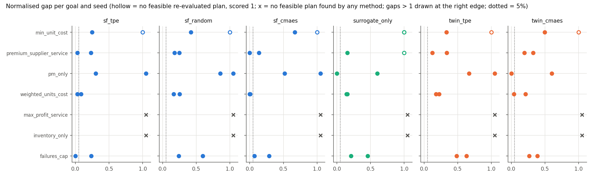
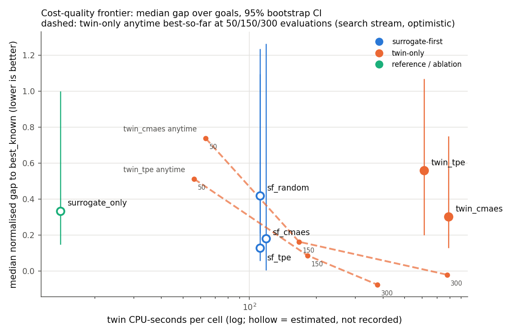
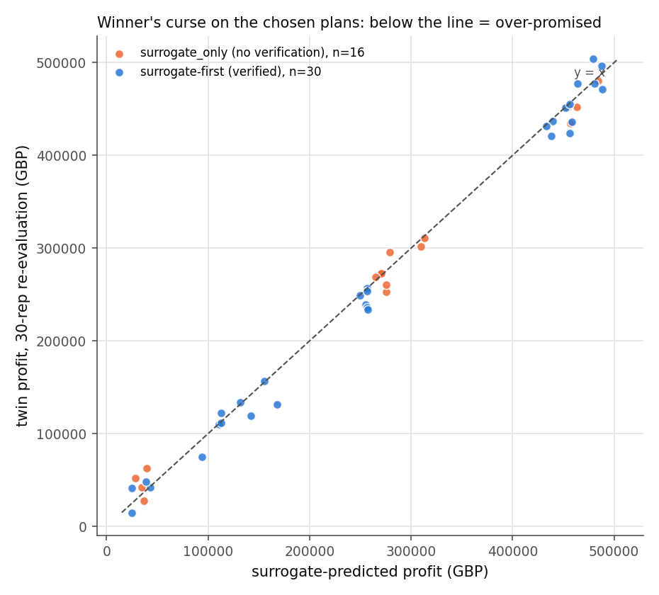

# Model D — the optimiser

Surrogate-first search with twin verification: search the surrogate cheaply,
shortlist distinct candidates, verify them on the twin, and re-evaluate the
chosen plan on a seed stream the search never touched. Benchmarked against
twin-only search and an unverified ablation on held-out goals, under a
pre-registration written before any held-out run
([preregistration_optim.md](../preregistration_optim.md)).

**Headline: all four pre-registered hypotheses FAIL as registered.** Two of
them (H2, H4) pass when the two held-out goals on which *no method found any
feasible plan* are excluded, which the pre-registration requires reporting
alongside. Section 4 has every number; section 9 says plainly where this fell
short of the spec.

---

## 0. What it optimises

**The twin, not a factory.** Every recommendation here is the best plan found
for a simulator whose `demand_capacity_ratio` — an assumption chosen to load the line
to about 85%, not measured — moves profit by 45% when changed by a quarter
([twin_design.md](twin_design.md)). The LLM layer only proposes scenario
parameters and writes explanations; every KPI, comparison and constraint check
here is deterministic Python.

---

## 1. Design

| Step | What happens | Where |
|---|---|---|
| 1. Search | An optimiser (TPE 3,000 trials, Sobol 50,000, CMA-ES 20,000) maximises the goal on the **surrogate**, with each hard constraint tightened by `margin_std` × the surrogate's predicted std (1.0, tuned on dev goals only) | `optim/optimisers.py` |
| 2. Shortlist | K = 20 **distinct** candidates (minimum normalised distance 0.15) | `select_diverse` |
| 3. Verify | All 20 on the twin, 10 reps, **search** stream. None feasible → widen the margin by 1 std and repeat, up to 3 rounds; still none → return the best with `status="infeasible_unverified"`, never a silent pass | `surrogate_first_verify` |
| 4. Re-evaluate | The chosen plan, 30 reps on the **reeval** stream, which no optimiser can reach | `TwinEvaluator(stream="reeval")` |

Ordering is **feasibility-first and lexicographic** — feasible beats infeasible,
then smaller violation, then objective — so no penalty weight converts stockout
probability into pounds.

### What the optimiser may change

16 controllables. The 2 exogenous dimensions are fixed at their defaults unless
a goal explicitly sets them as a what-if.

| Dimension | Kind | Bounds | Default (current policy) |
|---|---|---|---|
| `throughput_multiplier` | controllable | 0.7 – 1.3 | 1.0 |
| `shift_count` | controllable, integer | 1 – 3 | 2 |
| `overtime_hours` | controllable | 0 – 4 | 0 |
| `pm_interval_M1` … `M5` | controllable | 24 – 720 h | 168, 168, 120, 168, 240 |
| `speed_setpoint_M1` … `M5` | controllable | 0.8 – 1.2 | 1.0 |
| `reorder_point` | controllable | 0 – 9,000 | 7,000 |
| `order_quantity` | controllable | 100 – 10,000 | 6,000 |
| `safety_stock` | controllable | 0 – 4,000 | 1,500 |
| `supplier_choice` | **exogenous**, categorical | 0 / 1 / 2 | 0 |
| `price_multiplier` | **exogenous** | 0.85 – 1.25 | 1.0 |

### The methods compared

| Method | What it is | Budget |
|---|---|---|
| `sf_tpe` | surrogate-first, TPE search — **the pre-registered arm** | 3,000 surrogate trials |
| `sf_random` | surrogate-first, scrambled Sobol | 50,000 |
| `sf_cmaes` | surrogate-first, CMA-ES (one run per supplier when it is free) | 20,000 |
| `surrogate_only` | the ablation: surrogate argmax, **no verification**, then re-evaluated | 3,000 (matched to `sf_tpe`, Amendment 1) |
| `twin_tpe`, `twin_cmaes` | the same optimisers driving the twin directly | 300 evaluations × 5 reps |
| `best_known` | 500,000-point surrogate sweep, top 100 verified at 30 reps on reeval | — |

---

## 2. Scale: the two amendments

**Amendment 1 — matched ablation.** `surrogate_only`'s budget went from 20,000
to 3,000 trials, equal to `sf_tpe`'s, so H3 isolates verification rather than
comparing it against a 6.7× larger search. Made before any held-out result
existed.

**Amendment 2 — reduced scale.** The full design projected to 7.8 h (cool) to
14 h (hot) on the 8 GB laptop it runs on. Reduced, on runtime and goal
structure only and before any held-out result was looked at, to:

- **8 of the 12 held-out goals**, every goal family kept;
  `held_premium_supplier_service` kept over `held_offshore_supplier` as the
  only `downtime_hours` constraint. Reserve, never run: `held_max_profit`,
  `held_offshore_supplier`, `held_price_cut`, `held_speed_only`.
- **Seeds 1 and 2** for every method; **seed 1 only** for `best_known`.
- 104 cells. The 7 seed-3 cells already on disk were never opened by the
  analysis.

Consequences, stated in advance and borne out below: H1 is over at most 7
feasible goals (in the event, 5 — section 5), H4's infeasible-goal clause is
n = 1, seed variance comes from 2 replicates, and every interval is wide.

---

## 3. How the numbers are made

- **Every result is the chosen plan's 30-rep re-evaluation** on the reeval
  stream. A surrogate-first cell whose shortlist never verified feasible has no
  re-evaluation; it delivered no verified plan.
- **Normalised gap** = (best_known − method) / (best_known − baseline), where
  the baseline is the default Scenario on the goal's context, re-evaluated the
  same way (goal seed 1).
- **best_known**, as pre-registered, is the best point-feasible re-evaluated
  plan across the sweep *and* every method — so here no gap can be negative.
- **A plan that is infeasible on re-evaluation, or was never re-evaluated,
  scores gap = 1**: the operator keeps the current policy. The raw-objective
  gap is in the sensitivity table.
- A method's per-goal gap is the mean of its 2 seeds; aggregates are medians
  over goals with **paired bootstrap CIs resampling goals** (10,000 draws).
- These conventions were fixed before any held-out number was examined; the
  pre-registration is silent on them. They live in the docstring of
  `scripts/analyse_optim_benchmark.py`.

> **"Gap to best_known" is a lower bound on the true gap to the optimum.**
> best_known is surrogate-guided — the sweep is ranked by the surrogate and
> only its top 100 reach the twin — and it is not an oracle. A method at gap 0
> is "as good as the best anything found", not "the best possible".

---

## 4. Results

### Per-goal gap (mean of 2 seeds; lower is better)

| Goal | `sf_tpe` | `sf_random` | `sf_cmaes` | `surrogate_only` | `twin_tpe` | `twin_cmaes` |
|---|---|---|---|---|---|---|
| `held_failures_cap` | 0.118 | 0.418 | 0.179 | 0.333 | 0.558 | 0.327 |
| `held_weighted_units_cost` | 0.057 | 0.209 | **0.004** | 0.148 | 0.199 | 0.127 |
| `held_pm_only` | 1.094 | 1.235 | 1.263 | **0.301** | 1.068 | **0.301** |
| `held_premium_supplier_service` | 0.129 | 0.213 | **0.069** | 0.577 | 0.229 | 0.262 |
| `held_min_unit_cost` | **0.623** | 0.710 | 0.836 | 1.000 | 0.667 | 0.749 |
| **median** | **0.129** | 0.418 | 0.179 | 0.333 | 0.558 | 0.301 |
| 95% CI | 0.057 – 1.094 | 0.209 – 1.235 | 0.004 – 1.263 | 0.148 – 1.000 | 0.199 – 1.068 | 0.127 – 0.749 |

`held_inventory_only` and `held_max_profit_service` have **no feasible plan
from any method** (section 5) and so no reference; they cannot enter a gap.
`held_infeasible_profit_floor` is infeasible by design and excluded by rule.



### Sensitivity of the median gap

| Variant | `sf_tpe` | `sf_cmaes` | `surrogate_only` | `twin_tpe` | `twin_cmaes` |
|---|---|---|---|---|---|
| Primary (pooled reference, infeasible = 1) | 0.129 | 0.179 | 0.333 | 0.558 | 0.301 |
| Raw objective, feasibility ignored | 0.129 | 0.179 | 0.148 | 0.558 | 0.262 |
| Sweep-only reference (negative gaps possible) | 0.073 | 0.009 | 0.173 | 0.452 | 0.166 |

No variant moves `sf_tpe` below 5%. Under the sweep-only reference `sf_cmaes`
would sit at 0.9%, but that is not the pre-registered reference and is not used
for any verdict.

### Feasibility on re-evaluation (7 feasible goals × 2 seeds = 14 cells)

| Method | point | robust | point, excl. 2 no-feasible-plan goals (10 cells) | robust, excl. |
|---|---|---|---|---|
| `sf_tpe` / `sf_random` / `sf_cmaes` | 0.64 each | 0.50 each | **0.90** each | 0.70 each |
| `surrogate_only` | 0.50 | 0.43 | 0.70 | 0.60 |
| `twin_tpe` | 0.64 | 0.57 | 0.90 | 0.80 |
| `twin_cmaes` | 0.64 | 0.43 | 0.90 | 0.60 |
| `best_known` (1 seed, 7 cells) | 0.71 | 0.43 | 1.00 | 0.60 |

### Cost (mean per cell, all 8 core goals)

| Method | surrogate evals | twin runs | twin CPU-s | wall-s |
|---|---|---|---|---|
| `sf_tpe` | 6,018 | 381 | 107 (est.) | 565 |
| `sf_random` | 91,205 | 381 | 107 (est.) | 130 |
| `sf_cmaes` | 13,839 | 406 | 112 (est.) | 116 |
| `surrogate_only` | 3,000 | 30 | 11 (est.) | 310 |
| `twin_tpe` | 0 | 1,530 | 480 | 487 |
| `twin_cmaes` | 0 | 1,288 | 573 | 573 |
| `best_known` | 500,000 | 3,000 | 531 | 608 |

"est." — surrogate-first and `surrogate_only` cells recorded twin-run **counts**
but not twin CPU-seconds (a cost-accounting bug, section 9); their CPU-seconds
are runs × the same goal's measured twin-only CPU-seconds per run. TPE's
wall-time is dominated by Optuna's own sampler, not the surrogate:
`sf_random` evaluates 15× more points in a quarter of the time.



**The twin-only anytime curves are a warning, not a result.** Read off the
search stream at 5 reps, twin-only's best-so-far reaches a gap at or below 0 by
300 evaluations; the same searches' chosen plans, re-evaluated independently,
land at 0.56 (TPE) and 0.30 (CMA-ES). That is the winner's curse inside
twin-only search, and it is why every reported number is a re-evaluation.

---

## 5. Hypotheses

| | Verdict | Deciding number |
|---|---|---|
| **H1** median gap ≤ 5% | **FAIL** | `sf_tpe` median **0.129** (CI 0.057 – 1.094), 5 goals |
| **H2** matches/beats twin-only at ≤ 1/5 twin CPU | **FAIL** (with all goals) · PASS (excl.) | quality: ties with both; cost: twin-run ratio **0.229** vs TPE, **0.279** vs CMA-ES |
| **H3** ablation worse AND winner's curse | **FAIL** | ablation − `sf_tpe` gap **+0.204** (CI −0.793 – +0.448): a tie |
| **H4** feasibility ≥ 90% AND infeasible goal reported | **FAIL** (with all goals) · PASS (excl.) | `sf_tpe` point feasibility **9/14 = 64%**; 9/10 = 90% excluding |

**H1 — FAIL.** The median gap for `sf_tpe` is 12.9%, against a 5% bar. It is
computed over 5 goals rather than 7 because two feasible-by-design goals turned
out to have no feasible plan at all; scoring them would need a reference that
does not exist, so H1 cannot be computed "with" them. `sf_cmaes` (17.9%) and
`sf_random` (41.8%) also miss. The CI's upper end above 1 is `held_pm_only`
(section 6), and with 5 goals one bad goal moves the whole interval.

**H2 — FAIL as registered.** *Quality:* `sf_tpe`'s median gap is lower than
twin-only TPE's by 0.429 (CI −0.439 to +0.025) and than twin-only CMA-ES's by
0.172 (CI −0.209 to +0.793). Both intervals include 0, so by the pre-registered
rule both are **ties, which count as "matches"** — this half passes. *Cost:*
over all 7 feasible goals `sf_tpe` used **0.229** of twin-only TPE's twin runs
and **0.279** of CMA-ES's, above the 1/5 limit (estimated CPU ratios 0.212 and
0.176 — the two measures disagree for CMA-ES, and the measured run count fails
both). Most of the excess is surrogate-first spending all three verification
rounds (600 twin runs) on the two goals where nothing is feasible. **Excluding
those two goals**, as the pre-registration requires reporting alongside, the
run ratios are **0.163 and 0.191** (estimated CPU 0.182 and 0.141), and H2
**passes**. The registered verdict is FAIL.

**H3 — FAIL.** *Clause 1:* `surrogate_only`'s median gap exceeds `sf_tpe`'s by
0.204, but the paired CI (−0.793 to +0.448) contains 0 — a tie, not "worse".
*Clause 2:* the mean surrogate-minus-twin profit gap on `surrogate_only`'s
chosen plans is **+£416** over 14 cells (+£1,028 over all 16) — positive as
written, so the clause passes, but its CI (−£7,217 to +£8,051) is centred on
zero. **The winner's curse was not demonstrated**: at matched budgets the
unverified argmax did not measurably over-promise profit
([figure](../figures/d_optim_winners_curse.png)). Verification's value showed
up in **constraint** satisfaction instead — `surrogate_only` was feasible in
7/10 cells against 9/10 — which H3 does not measure.



**H4 — FAIL as registered.** `sf_tpe` delivered a point-feasible re-evaluated
plan in 9 of 14 cells (64%); robust feasibility 50%. Excluding the two goals
with no feasible plan, 9 of 10 (**90%, exactly at the bar**), and H4 passes.
*Infeasible-goal clause:* on `held_infeasible_profit_floor` every surrogate-
first cell (3 arms × 2 seeds) returned `status="infeasible_unverified"`, as did
every other method — **this clause rests on n = 1 goal**, because the held-out
library only ever had one infeasible-by-design goal.

Nothing — goals, margins, methods, reserve goals — was changed in response to
any of these numbers.

---

## 6. Per-goal findings

### `held_inventory_only` and `held_max_profit_service`: no feasible plan exists

The run log showed every surrogate-first cell on these two goals ending
`infeasible_unverified`. The independent evidence says that is **(a) the goal
is infeasible, a goal-design flaw — not (b) a surrogate-first failure**:

- **best_known:** none of the 100 sweep plans verified at 30 reps on the
  reeval stream is feasible on either goal.
- **Twin-only:** neither twin-only method, on either seed, re-evaluated a
  feasible plan, and neither *ever saw* a feasible point during search
  (search stream, 5 reps; ~2,070 evaluations across the two goals — 866 on
  `held_inventory_only`, where CMA-ES stopped early on its own criteria, and
  1,200 on `held_max_profit_service`).
- The baseline is infeasible on both.
- Closest anything came on re-evaluation: `held_inventory_only` stockout
  **0.205** against ≤ 0.10; `held_max_profit_service` on-time **0.805**
  against ≥ 0.90 and stockout **0.219** against ≤ 0.10. These are misses by a
  factor of two, not by noise.

So both are reported **with and without**, per verdict rule 3: the "excl."
columns and verdicts above are the "without". *Exploratory:* the surrogate's
bias on the constrained KPIs is small here (stockout −0.015 to +0.007,
on-time +0.014) — the surrogate itself predicted ~0.20–0.22 stockout, so
surrogate-first's answer was right; its three margin-widening rounds were wasted
twin budget on a goal it had correctly judged impossible.

These two goals' thresholds were copied from the twin's service constraints
without checking them against the held-out contexts (21 and 27). That check was
missing from goal design, and it cost H2 and H4 their registered verdicts.
`held_inventory_only` was also the only goal on which grid search applied, so
grid was never exercised on held-out data.

### `held_failures_cap` — the surrogate's weakest KPI (`unplanned_failures`, R² 0.733)

Every method, verified or not, was feasible on both seeds, and robustly. The
cap (≤ 0.5) was not where the difficulty lay: the surrogate **over**-predicts
failures on the chosen plans (+0.16 for surrogate-first, +0.05 for
`surrogate_only`; *exploratory*), a conservative error. **Twin verification did
not need to rescue this goal** — `surrogate_only` was feasible too — but
surrogate-first chose better plans: `sf_tpe` 0.118 against `surrogate_only`
0.333 and twin-only 0.33 – 0.56. Twin CPU-seconds on this goal are inflated
about 10× (1.63 s per run against 0.14 – 0.21 elsewhere) because its twin-only
cells ran in the first, memory-thrashing 6-worker attempt; run counts are
unaffected.

### `held_premium_supplier_service` — `downtime_hours` (R² 0.907)

The downtime cap (≤ 20 h) never bound — chosen plans ran 5 – 9 h. The binding
constraint was on-time delivery ≥ 0.93, which the surrogate **over**-predicts
(+0.010 surrogate-first, +0.021 `surrogate_only`; *exploratory*). Here
**verification did rescue it**: all 6 surrogate-first cells were feasible on
re-evaluation (3 robustly), while `surrogate_only` failed on seed 2 (gap 1.0,
median 0.577 against `sf_tpe`'s 0.129). `sf_cmaes` reached the reference on
seed 2.

### `held_pm_only` — a flat landscape, and a margin that cost the optimum

*Exploratory.* Within the 28-day horizon, any PM interval long enough never
fires, so every such plan produces identical twin output (`surrogate_only`,
`twin_cmaes` and `best_known` hit exactly the same objective, and CMA-ES stopped
after ~80 evaluations). The optimum is "effectively no PM". Surrogate-first
chose short intervals instead (37 – 133 h), paying ~18.6 h of PM downtime for
zero failures, and landed **worse than the current policy** (gaps 1.09 – 1.26).
The mechanism: the surrogate predicts ~0.36 failures where the twin sees 0, and
the 1-std safety margin tightened the ≤ 1.0 cap to an effective ~0.36. The
unverified `surrogate_only` had no margin and found the plateau. This is the
safety margin working as designed — conservative under a biased constraint KPI
— and being wrong for this goal.

### `held_min_unit_cost` — verification on noisy seeds

**Of 30 surrogate-first plans verified feasible at 10 reps on the search
stream, 27 were still feasible on the independent 30-rep re-evaluation (90%).**
All 3 reversals are on `held_min_unit_cost`, seed 2, one per arm. Its on-time
≥ 0.85 constraint sits on the edge of what is achievable (best re-evaluated
0.853), and *no* plan on this goal — from any method — was robustly feasible.
Twin-only reversed the same way on seed 2. The finding is about verification,
not this goal: **10 search-stream replications accept plans that are feasible
within noise of the boundary, and a different seed set then puts them on the
other side.** A robustness margin at verification (mean − k·sem), or more
verification reps near a boundary, would be needed to close it.

---

## 7. The novelty signal

A0 measured the k-NN novelty scorer at **AUROC 0.912** separating
out-of-distribution scenarios from T1 (gate 0.75), so it was marked
**active**. In the optimiser it was **computed for every shortlisted plan and
stored, and nothing else**: neither the ranking, the shortlist, the margin nor
the stopping rule reads it, and no "novel" flag is defined. **It changed no
candidate selection, and it flagged 0 chosen plans.**

Descriptively (*exploratory*; there is no pre-registered threshold): the 48
surrogate-first chosen plans scored 0.774 – 1.236 (median 0.901); 31 sit above
A0's in-distribution mean (0.872) and 12 above the OOD set's mean (1.006). Some
chosen plans are as far from the training data as A0's deliberately-OOD
corners, and nothing acted on it.

---

## 8. Speed basis

The surrogate evaluates a scenario in 0.079 ms in batch; a 30-rep twin
evaluation takes 4.65 s — **59,015×** — and a single twin run ~0.155 s, so
about **1,970×** per run (59,015 / 30). In the benchmark, measured twin runs
took 0.14 – 0.21 s each. The speed-up is what makes a 500,000-point sweep cost
about 40 s of surrogate time — the price of ~255 single twin runs; it does not
make the sweep's ranking right, which is the point of verification.

---

## 9. Underperformed the spec

- **All four hypotheses fail as registered.** H1 by a wide margin (12.9% vs 5%);
  H3 because neither of its effects was resolved; H2 and H4 pass only without
  the two infeasible goals.
- **Two of seven feasible held-out goals are infeasible.** Goal thresholds were
  not validated against their held-out contexts. It could not be fixed after
  the fact without editing goals after seeing results, which the
  pre-registration forbids.
- **The novelty signal was gated active and wired in as advisory.** A0's gate
  decision was not implemented in selection.
- **Surrogate-first did not record twin CPU-seconds.** The cost was rebuilt by
  hand from the twin-run count and the measured CPU-seconds were dropped, so
  H2's cost clause rests on run counts plus an estimate. Fixed after the run
  (`surrogate_first.py` now merges each twin evaluator's measured cost, with a
  regression test); the benchmark was not re-run.
- **"CPU-seconds" is elapsed time around the twin loop**, so it is inflated by
  contention (~10× on `held_failures_cap`).
- **An infeasible surrogate-first exit returns a search-stream plan with no
  re-evaluation**, so those cells have no independent number.
- **Verification at 10 reps lets boundary plans through** (3 of 30 reversed).
- **Grid search was never benchmarked** on held-out data.
- **Reduced scale** (Amendment 2): 8 goals × 2 seeds, `best_known` on one seed,
  4 goals held in reserve for cost, intervals wide enough that most method
  comparisons are ties.
- Two production crashes (a Sobol balance bug, then out-of-memory at 6 workers)
  preceded the run that produced these results; both were fixed without
  changing any budget, goal or hypothesis.

---

## 10. Limitations

- **Reduced scale.** 5 – 7 goals per aggregate and 2 seeds per method: CIs span
  most of [0, 1] and a single goal (`held_pm_only`) moves a median. Four goals
  — `held_max_profit`, `held_offshore_supplier`, `held_price_cut`,
  `held_speed_only` — were held in reserve for cost and are untested; the price
  what-if is not tested on held-out data at all.
- **`demand_capacity_ratio` dominates.** A 25% change moves twin profit 45%; it
  is an assumption. Every absolute profit figure here is conditional on it.
- **Surrogate misses.** `unplanned_failures` (R² 0.733) and `downtime_hours`
  (0.907) are the weak KPIs; the first drove the over-conservative margin on
  `held_pm_only`. The surrogate over-predicts on-time delivery on the chosen
  plans, which is why verification mattered on the service goals.
- **`best_known` is not an oracle**, and on one seed. Gaps are lower bounds.
- **The twin's 28-day horizon** makes long PM intervals free, which is a
  property of the simulator and not a maintenance policy anyone should adopt.
- **Both amendments** are in the pre-registration with their reasons:
  Amendment 1 matched the ablation's budget to the arm it ablates; Amendment 2
  cut the scale for runtime on an 8 GB laptop. Neither was made after a held-out
  result had been seen.

---

## 11. Reproduce

```bash
python scripts/run_optim_benchmark.py --workers 3
python scripts/analyse_optim_benchmark.py
```

The benchmark resumes from its results tree and reads its design from
`configs/benchmark_design.yaml`; the analysis reads only the design's cells and
writes `reports/results/optim_benchmark_analysis.json` and the three
`d_optim_*.png` figures.
