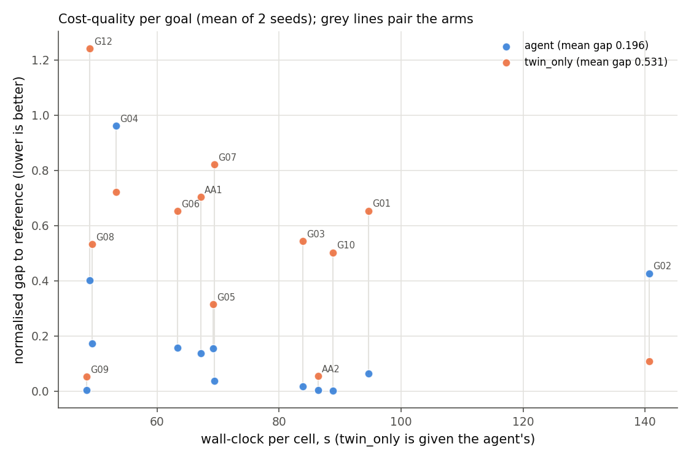
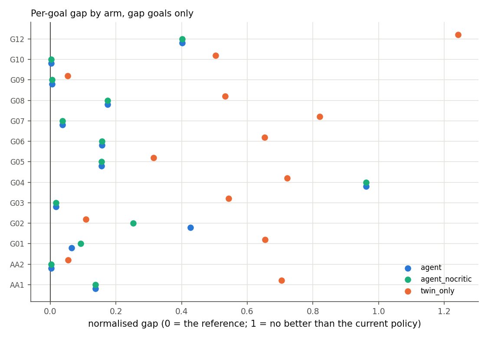
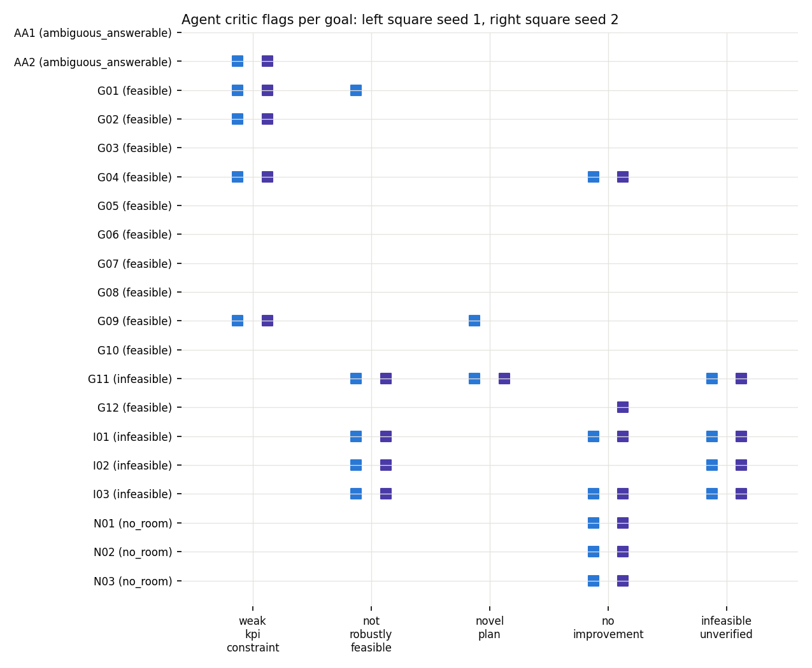

# Model F — the agent benchmark

The agent (Prompt 8) measured on **20 new goals** it was never tuned on, against
CMA-ES driving the twin directly at equal wall-clock, with the critic ablated,
under a pre-registration committed before any run
([preregistration_agent_bench.md](../preregistration_agent_bench.md), Amendment
A.1 included).

**Headline.** B1, B3 and B4 **PASS**; B2 and B5 **FAIL**.

- The agent's plans are much closer to the reference than twin-only's (mean gap
  0.196 against 0.531).
- The critic removes 11 of 12 bad recommendations.
- Every impossible and pointless goal is handled correctly.
- **B2 fails by one cell** (95.7% against 96.9%).
- **B5 fails on the explanation clause**: 35/40, where 40/40 was required.

---

## 1. Design

**Why new goals.** The agent's optimiser variant (`sf_tpe`) was chosen on the 8
core held-out goals, so they could not be reused. The 20 goals sit on T1
contexts 8–19, which no dev, core or reserve goal uses
(`tests/data/agent_bench_goals.yaml`).

**Goal mix: 11 feasible / 4 infeasible / 3 no-room / 2 ambiguous-but-answerable,
not the 12 / 3 / 3 / 2 first specified.** Every label was checked on the twin at
a small budget before pre-registration:

- **G11 relabelled infeasible.** It was written as feasible, but the offshore
  supplier's 21-day lead time keeps on-time delivery below 0.70 even for the
  current policy.
- **N01 and N02 redesigned.** Their first versions turned out to have room:
  safety stock moved OEE by +0.040, and the reorder point cut downtime by 6.8 h.
- **All three no-room goals are therefore PM-interval levers**, each with
  **exactly one free dimension** (N01: profit via M5's interval; N02: on-time
  via M4's; N03: on-time via M5's). That is a narrow kind of "no room".

**Arms**, all on the **gold** spec, so optimisation is measured separately from
parsing. Seeds 1 and 2; every final plan is re-evaluated at 30 reps on the
independent reeval stream, paired with the baseline.

| Arm | What it is |
|---|---|
| `agent` | Explorer, evaluator and critic with its one retry. `sf_tpe` at **600 TPE trials — the interactive profile, not the 3,000-trial configuration benchmarked in d_optimiser.md**; K = 20; 10 verification reps; one round. No LLM. |
| `agent_nocritic` | The explorer's first plan, before the critic, from the same trace. |
| `twin_only` | CMA-ES on the twin, 5 reps per evaluation, for **exactly the agent's measured wall-clock** on that goal and seed, restarted on early convergence. |
| `baseline` | The current policy. |

**Smoke test, before the main run** (2 dev goals, seed 1, 2 workers): 4 cells,
0 failures, 3.7 min. Agent cells took 76.9 s and 105.5 s; twin-only searched
70.4 s and 99.5 s against agent budgets of 70.2 s and 98.8 s; peak memory per
worker was 0.42–0.45 GB resident and 1.22–1.25 GB committed.

**Main run.** 80 cells on 3 workers in 39.7 min, plus a 125 s re-run (below).
Agent wall-clock per cell: median 68 s, range 46–166 s.

---

## 2. The A.1 incident

The main run wrote **74 of 80** cells. All 6 failures were `twin_only` on N01,
N02 and N03, both seeds, each with
`ValueError: not yet initialized (dimension needed)`.

- **Root cause: a pycma 4.5.0 bug that only bites in one dimension.** With
  bounds, pycma caps each coordinate's step size at a third of the range. When a
  step crosses that cap, `DiagonalDecoding.set_i` treats a size-1 scaling vector
  as "not yet initialized" and raises. In one dimension an initialised vector
  is size 1 too; in two or more dimensions the cap is simply applied.
- **Why only N01–N03.** They are the only one-dimensional goals. Their flat
  objectives made CMA-ES stop and restart many times within its budget, so some
  seed always crossed the cap.
- **Fix** (Amendment A.1, a decision the pre-registration was silent on): treat
  that error as the end of the CMA-ES run, keep every point already evaluated,
  and restart under the pre-registered rule. Behaviour in two or more
  dimensions is unchanged.
- **No outcome was inspected before the fix.** The diagnosis used the code, the
  gold specs and offline reproductions.
- **Before the change**, the sha256 of the manifest and all 74 cells was
  recorded (`reports/results/agent_bench_cell_sha256_before_A1.txt`). **After
  it**, and again at analysis time, all 75 were byte-identical.
- **Only the 6 failed cells were re-run** (125 s, 0 failures). The original
  failure records remain in `data/processed/agent_bench/full/failures/`.

**Even after the fix, twin-only on N01–N03 is many short restarts**: 64
evaluations per cell across 9–16 restarts, about 4–7 evaluations each. CMA-ES
is not designed for one dimension, so read twin-only's numbers on those goals
with that in mind.

---

## 3. Results

| | Verdict | Deciding number |
|---|---|---|
| **B1** agent non-inferior to twin-only on normalised gap | **PASS**, and superior | mean(agent − twin-only) = **−0.335**, 95% CI −0.520 to −0.141, 13 goals (bound +0.10) |
| **B2** robust-feasibility rate of recommended plans, agent ≥ twin-only | **FAIL** | agent **22/23 = 95.7%** against twin-only **31/32 = 96.9%** |
| **B3** critic on vs off: fewer bad recommendations | **PASS** | agent **1** against no-critic **12** |
| **B4** all 4 infeasible goals declared infeasible with options; ≥ 2 of 3 no-room goals flagged | **PASS** | 4/4 infeasible on both seeds; 3/3 no-room flagged and not recommended on both seeds |
| **B5** planner spec-match ≥ 85% AND 100% of explanations pass | **FAIL** | planner **20/20**; explanations **35/40** |

### B1 — gap to the reference

The reference is the best re-evaluated feasible plan across all arms and both
seeds, so **a gap is a lower bound on the true gap, not a distance to an
optimum**. Per goal (mean of the 2 seeds; 0 = the reference, 1 = no better than
the current policy):

| Goal | agent | agent_nocritic | twin_only |
|---|---|---|---|
| G01 | 0.064 | 0.092 | 0.654 |
| G02 | **0.427** | 0.253 | **0.109** |
| G03 | 0.017 | 0.017 | 0.543 |
| G04 | **0.962** | 0.962 | **0.722** |
| G05 | 0.156 | 0.156 | 0.314 |
| G06 | 0.157 | 0.157 | 0.653 |
| G07 | 0.037 | 0.037 | 0.821 |
| G08 | 0.174 | 0.174 | 0.532 |
| G09 | 0.005 | 0.005 | 0.052 |
| G10 | 0.003 | 0.003 | 0.503 |
| G12 | 0.401 | 0.401 | 1.242 |
| AA1 | 0.138 | 0.138 | 0.704 |
| AA2 | 0.003 | 0.003 | 0.055 |
| **mean** | **0.196** | **0.185** | **0.531** |

Twin-only wins on **G02** and **G04**; the agent wins everywhere else.
Twin-only's G12 plan is feasible but worse than the current policy (gap 1.242).

**Unstable denominators (flag is post-hoc; the pre-registered rule is
unchanged).** Some goals' reference beats the baseline by less than twice the
baseline's own 95% CI half-width:

- **G04 seed 2: exactly 0.** The reference *is* that seed's baseline, so the
  pre-registered rule excludes the seed and G04's gap rests on seed 1, whose
  ratio is only 1.18.
- **G12 seed 2: 1.31. G07 seed 2: 1.46. G08 seed 2: 1.64.**

*Post-hoc sensitivity, no verdict:* without those four goals the B1 difference
is −0.291 (CI −0.476 to −0.090, n = 9), so the conclusion does not depend on
them.




### B2 — robust feasibility of recommended plans

The agent recommended 23 plans and 22 were robustly feasible; the exception is
G01 seed 1. Twin-only "recommended" 32 and 31 were robust.

**The comparison is not like for like.** Twin-only has no critic: under its
pre-registered rule it recommends every plan that was feasible on its own
search stream. **17 of its 32 recommended plans do not beat the current
policy.** Those are trivially robust, and B2 rewards them. The agent declined
17 plans: all 8 infeasible-goal cells, all 6 no-room cells, both G04 cells and
G12 seed 2. B2 still fails as registered.

### B3 — the critic

Bad means recommended AND (not robustly feasible OR not beating the current
policy). The no-critic arm made **12** bad recommendations:

- all 6 no-room cells (no improvement);
- both G04 cells and G12 seed 2 (no improvement);
- G01 seed 1, G02 seed 2 and G10 seed 2 (not robust).

The critic left **1**: G01 seed 1, which was still not robust after its one
retry. Critic actions across the 40 cells: 29 accept, 10 explore again then
accept, 1 swap then accept.

The critic cost gap on **G02** (0.427 with it against 0.253 without): its retry
on seed 2 traded objective for robustness.

### B4 — impossible and pointless goals

All 4 infeasible goals (I01–I03 and G11) ended `infeasible` on both seeds, each
with closest-achievable options. All 3 no-room goals were flagged
`no_improvement` and not recommended on both seeds.

The no-room clause passing says less than it seems: all three goals are
PM-interval levers with one free dimension, on contexts where those intervals
barely act.



### B5 — parsing and explanation

**Planner v3: 20/20 spec-matches.** Every NL goal produced a spec; there were 0
clarifications, 0 refusals and 0 invalid specs. **The benchmark has no
clarification-needed goal**, so the earlier 4/6 clarification miss (Prompt 8
test split) is **not retested here**.

**Explainer on the 40 agent results**, three ways:

| Count | Passed |
|---|---|
| First attempt | **30/40** |
| LLM text, within the one permitted regeneration — **the pre-registered criterion** | **35/40** |
| Including the template fallback | 40/40 |

The pre-registration counts a template fallback as a failure, so **B5 fails on
the explanation clause: 35/40 against 100%.** The 5 fallbacks were AA2 seed 1,
G01 seed 2, G03 seed 1, G10 seed 1 and N02 seed 1. The audit used 70 of its 120
LLM calls.

**Post-hoc, no verdict: why the 10 retried or fallen-back explanations failed
their first attempt.** By reading the checker's 25 recorded first-attempt
reasons, with the checker unchanged:

| Kind | Items | What it was |
|---|---|---|
| **Real error** | 3 | "downtime hours **fall** from 14.69 to 20.05" (AA2 s2); "downtime hours **fall** from 10.66 to 12.02" (G02 s1); and a garbled self-correction in the same G02 s1 text |
| Checker false flag: scientific notation | 8 | N02 seed 1 copied facts written like `-1.208e-05`; the number check splits them into "1.208" and "05" |
| Checker false flag: explanatory phrasing | 12 | e.g. "a decrease …, which is worse when higher is better". The direction stated is correct; the "higher" belongs to the phrase. A few attach a list's direction word to the wrong KPI. |
| Undeterminable | 2 | the stored 80-character excerpt is too short to tell |

- **Negation false flags: 0.** I predicted these in Amendment A.1; no failure
  involved a delta of exactly zero, so the prediction did not hold.
- **All 5 template fallbacks began from false flags only.** The retries'
  reasons were not stored, so why each retry also failed is unknown.
- **Only 2 of the 10 cells show a clear real error at the first attempt.**

The B5 explanation verdict stays **FAIL**. The evidence suggests it is mostly a
**checker precision problem** — the explainer's own prompt invites "worse when
higher is better" phrasing, and the facts allow scientific notation — rather
than fabricated claims.

> **What B5 measured.** B5 was measured with **explanation checker v1** and the
> **original facts format** (4 significant figures, scientific notation
> allowed). The live agent now uses **checker v2 and plain-decimal facts, which
> have NOT been benchmarked.** B5 stands as registered: **FAIL, 35/40.** The
> post-benchmark work in section 8 also found that one of those 35 passes
> (I01 seed 1) contains a direction error v1 could not see.

---

## 4. Twin-component ablation (exploratory, pre-declared)

Each agent final plan and its baseline were re-evaluated at 30 paired reps with
`hazard_source` switched from `learned` to `fixed_mtbf`, a twin-config value.

- **Rankings mostly hold.** Plan minus current policy keeps its sign in **37 of
  40** cells. "Beats the current policy" changes in **1** cell: I02 seed 2, an
  infeasible goal.
- **Levels move a lot.** The baseline's unplanned failures go from 0.66 to
  **2.10** (×3.2), downtime rises **+3.5 h**, and profit falls **£6.1k**.
- **Feasibility flips in 7 cells**: AA2 (both seeds), G01 (both), G02 seed 1
  and G09 (both). **Every one is a goal constraining downtime or failures**,
  feasible under the learned hazard and infeasible under fixed MTBF.

The agent's feasibility verdicts on weak-KPI goals therefore depend on the
health model's assumption, which is the risk the `weak_kpi_constraint` flag
names.

**Quantile vs point demand: not run.** The twin has no point-demand mode. Its
only lever, `demand_spread_multiplier = 0`, collapses each *randomly sampled*
path to a constant at that path's own median, which is not the forecast's
median path. Producing point demand would need a code change.

---

## 5. Underperformed the spec

- **B2 FAIL**: 95.7% against 96.9%. That is one cell, but a failure as
  registered, and the comparison favours an arm with no critic (section 3).
- **B5 FAIL** on the explanation clause: 35/40 against 100%. Most first-attempt
  failures were checker false flags, which is itself a shortfall: the checker
  shipped in Prompt 9 is too imprecise for a 100% bar.
- **The goal mix deviates**: 11/4/3/2 instead of 12/3/3/2, after G11 was
  relabelled.
- **All three no-room goals are one-dimensional PM levers**, which makes B4's
  no-room clause a narrow test.
- **The A.1 incident**: 6 cells crashed on a library bug the smoke test could
  not reach (the smoke goals had many free dimensions). They were fixed and
  re-run under an amendment.
- **The planner audit has no clarification-needed goals**, so the earlier 4/6
  clarification miss is not retested.
- **The agent ran 600 TPE trials, not the 3,000 benchmarked** in d_optimiser.md,
  and the benchmark measured that interactive configuration.
- **The critic hurt one goal** (G02: gap 0.253 → 0.427) and **twin-only beat the
  agent on two** (G02, G04).
- **Point-demand ablation not run** (unsupported without code changes).

---

## 6. Limitations

- **Small sample.** 20 goals, 13 of them gap goals, and 2 seeds. Per-goal
  results come from 2 replicates; G04's gap rests on one seed.
- **The reference is a lower bound**: the best plan any arm found, not the
  optimum.
- **The optimiser was chosen on the core goals** and is run here at a reduced
  budget.
- **Twin-only on N01–N03 is effectively many short restarts.**
- **Free-tier LLM** (`openai/gpt-oss-20b`; 8,000 tokens per minute, 1,000
  requests per day). The audit is one run per item, and its numbers move by 2.5
  points per explanation.
- **Hazard dependence.** Feasibility on the weak-KPI goals depends on the
  hazard model (section 4).
- **The twin is not a validated model of a real factory.** Every number here is
  a statement about the simulator.

---

## 7. Reproduce

```bash
python scripts/run_agent_bench.py --workers 3
python scripts/run_agent_bench.py --audit
python scripts/analyse_agent_bench.py
python scripts/ablate_agent_bench.py --workers 3
```

---

## 8. Post-benchmark offline re-check (not a test result)

**B5 is unchanged: it FAILED as registered (35/40).** This section reports
work done after the benchmark, on stored data, with no LLM call. The benchmark
audit was not re-run. **Checker v2 and the plain-decimal facts have not been
benchmarked**; nothing here is a test result.

**Explanation checker v2**
(`src/twinmind/agents/explanation_v2.py`) fixes the three false-flag patterns
in section 3's post-hoc reading:

- **Scientific notation.** v2 reads `1.208e-05` as one number. Its facts are
  rounded per KPI, with units, so the model no longer sees such numbers.
- **Trailing convention clauses** such as "…, which is worse when higher
  values are better". v2 strips convention phrases and attributes a direction
  word within its own clause. A clause that names nothing and follows a comma
  ("OEE falls …, a decrease of 0.045") continues the previous clause's KPI;
  nothing carries across while/whereas/but or a semicolon.
- **List attribution.** v2 prefers the KPI a direction word directly modifies;
  a verb with no subject applies to the list after it ("reducing costs,
  downtime, and failures").
- **snake_case KPI names** ("stockout_probability rises") are recognised. v1's
  `\bdowntime\b`-style aliases cannot match before an underscore, so v1 never
  checked these.

v2 also refuses the three overclaiming words the dashboard never shows
(`FORBIDDEN_WORDS` in that module). v1 is untouched, so the
benchmark remains reproducible.

The comma carry-over, list rule and snake_case names were added in Prompt 10
Stage B **because the mutation test below showed v2 missing errors v1 caught**
(and an error both missed). The stored texts and the false-flag regression
tests were the guard: none may start failing.

**Regression tests built from the stored failure texts**
(`tests/test_explanation_v2.py`):

- **9 false flags:** v1 flags each one and v2 does not.
- **2 real errors** ("downtime hours fall from 14.69 to 20.05", and "… from
  10.66 to 12.02", both while downtime rose): flagged by both versions.
- **4 excluded.** For AA2 s1, G02 s2, G03 s2 and G04 s2, the flagged word lies
  past the stored 80-character excerpt, so which KPI it described cannot be
  known. This corrects section 3: I had counted AA2 s1 and G02 s2 as
  misattribution false flags, but the excerpt cannot show that.

**Re-check of the 40 stored explanations**
(`reports/results/explanation_check_v2_offline.json`): **v1 passes 40/40, v2
passes 39/40.** The one v2 failure is a **real error**: I01 seed 1 says
"stockout_probability rises to 0.1901 from 0.2309", but it fell (delta
−0.04074). v1 passed it because it cannot see snake_case names, so it was
counted among B5's 35 passes. B5 is not re-scored. What was stored is each
cell's *final* text — the passing LLM text, or the template — so this cannot
re-score the failed attempts, which were never stored. Every attempt's text and
checker reasons are now recorded in the AgentResult and the run log. The
dashboard's demo cache uses I01 seed 2 instead of seed 1.

### Mutation test (post-benchmark, not a test result)

`scripts/mutation_test_explanations.py` →
`reports/results/explanation_mutation_v2.json`. No LLM call. Each stored text
that passes both checkers (39; I01 s1 excluded) is corrupted with **one**
mechanical edit per mutant, and both checkers audit every mutant against the
same v1 facts the text was written from. Sites are found by the script's own
patterns, not by either checker's.

| Corruption | v1 caught | v2 caught |
|---|---|---|
| Direction word flipped (all sites) | 306/431 (71%) | **377/431 (87%)** |
| … in a KPI sentence | 306/397 (77%) | **377/397 (95%)** |
| … in a plan-change sentence ("safety stock rises") | 0/34 (0%) | 0/34 (0%) |
| Stated number changed (×1.25 or ×0.6, off every fact) | 1202/1203 | 1202/1203 |
| KPI name swapped (fixed cycle, all) | 74/262 (28%) | 74/262 (28%) |
| … to a KPI whose delta has the opposite sign | 74/94 (79%) | 74/94 (79%) |
| Claim negated ("rises" → "does not rise"; "is recommended" ↔ "is not recommended") | 0/244 (0%) | 0/244 (0%) |

**Corruptions v1 catches and v2 misses: 0** (71 the other way). Before the
fixes above, the first v2 missed 119 that v1 caught — 117 direction flips in
", a decrease of …" clauses and lists, and 2 KPI swaps — which is why it was
changed.

What neither checker catches, plainly:

- **Negation: nothing.** Both checkers look for direction words and ignore
  "not". "Profit does not rise" when it rose, or "the plan is not recommended"
  when it is, passes both.
- **Plan-change directions: nothing.** A wrong direction for a decision
  variable ("safety stock falls" when it rose) is not checked by either.
- **Same-sign KPI swaps.** Neither checker ties a number to the KPI it is
  stated for, so swapping to a KPI that moved the same way is invisible.
- **Of the 20 missed KPI-sentence flips**, 8 are real misses by both (G11 s1:
  "…; the delta is 5480.0, which is lower" — a semicolon starts a new subject),
  8 flip a convention phrase the generator failed to skip ("*Better_when* is
  higher") and 4 flip words inside a negated list ("none of the metrics rises,
  increases …"); those 12 are not real errors.
- **Number changes: 1 miss**, where the changed value equals a number inside a
  flag message.

These gaps are why the dashboard shows the twin's KPI table, with intervals,
beside every explanation: the table is the record, and the explanation is a
reading of it.

**How to read these numbers.**

- **(a) Development results, not validation.** v2 was changed until its
  v1-only misses were zero **on this same mutation set**, so the catch rates
  above measure the set it was tuned on. They are not an independent
  validation of v2.
- **(b) B5's count is no bound.** I01 seed 1 passed v1 and is counted inside
  B5's 35/40, but fails v2 with a real direction error; and v1 also rejected
  correct texts (the false flags in section 3). So 35/40 is neither a lower nor
  an upper bound on explanation quality.
- **(c) B5's verdict is unchanged: FAIL, 35/40.**
